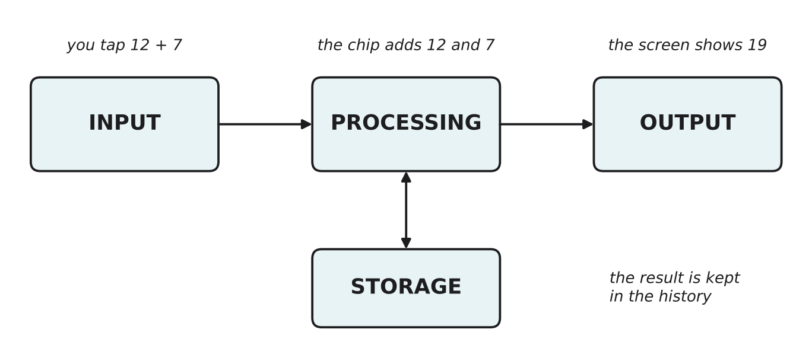

# 1.1 What is a computer?

Author: Matashev Ariet 1820262363 | Reviewed by: Mussaldinov Rassul 1820262146 | Status: checked

This is the first lesson of the module. You do not need to read anything before it.

## After this section you can

- name the four jobs every computer does
- sort the parts of a device into input, processing, storage and output
- explain the difference between hardware and software
- decide whether an unusual device counts as a computer, and explain why

## Start with an example

Open the calculator on your phone and type 12 + 7.

1. You tap the numbers on the screen. The phone takes in information.
2. The phone works out the answer. It does something with the information.
3. The calculator keeps your last result in its history. It saves information.
4. The screen shows 19. The phone gives information back to you.

These four steps have names: **input**, **processing**, **storage** and **output**.

*Figure 1.1.1: The four jobs of a computer, using the calculator example. Processing can save things to storage and read them back.*

## Words you need

- **Input:** information going into the computer (your taps).
- **Processing:** the computer working on that information by following instructions (adding 12 and 7).
- **Storage:** the computer keeping information for later (the history).
- **Output:** information coming out of the computer (19 on the screen).
- **Computer:** a machine that takes input, processes it by following instructions, can store information, and produces output.
- **Hardware:** the physical parts you can touch.
- **Software:** the instructions that tell the hardware what to do.

## Explanation

### Computers are everywhere

By this definition, a lot more than laptops count as computers. A smart watch, a washing machine that runs different programs, a car's engine control and a robot vacuum all take input, process it, store information and produce output.

The important word in the definition is **instructions**. A simple light switch also has an "input" (you press it) and an "output" (the light), but it does not follow a list of instructions or store anything, so it is not a computer.

### Hardware and software

- **Hardware** is the physical part of a computer: the screen, the keyboard, the chips inside.
- **Software** is the instructions: apps, games, the operating system.

The hardware is the same whether you open the calculator or a game. What changes is the software. Lesson 1.3 explains how one machine can run any software: the instructions are stored in memory, just like data.

### Meet Dusty

In this module we follow one robot vacuum. We call it **Dusty**. Dusty needs hardware to sense and move (Part 1), a network to talk to your phone (Part 2), and simple behaviorist AI to decide what to do (Part 3). In Part 4 we put all three together.

## Worked example: Dusty's four jobs

- **Input:** a bump sensor feels when Dusty hits a chair; a sensor underneath notices the edge of the stairs; the phone app tells it to start cleaning.
- **Processing:** a small chip inside decides what to do next, for example "I hit something, so turn right".
- **Storage:** Dusty saves a map of the room so it does not clean the same spot twice.
- **Output:** the wheels turn, the brushes spin, and the app shows "Cleaning finished".

Notice that one device can have many inputs and many outputs. The part that decides what to do (processing) sits in the middle of all of them.

## Try it yourself

**Q1. Sort.** Put each part into input, processing, storage or output:
keyboard, microphone, CPU, SSD, speaker, camera, printer, USB flash drive, touchscreen.

**Q2. Apply.** Think of a cash machine (ATM). Give one example of input, processing, storage and output.

**Q3. Decide and explain.** A friend says: "A washing machine is not a computer, it just washes clothes." Do you agree? Explain using the four jobs.

**Q4. Hardware or software?** Is a game you download hardware or software? What about the phone you play it on?

**Q5. Find the error.** A classmate wrote: "Dusty's map of the room is output, because Dusty makes it." What is wrong, and what is the correct job?

**Q6. Predict.** Dusty's bump sensor breaks, but everything else still works. Which of the four jobs is affected, and what will Dusty probably do when it reaches a chair?

## Answers

**Q1.**

- Input: keyboard, microphone, camera
- Processing: CPU
- Storage: SSD, USB flash drive
- Output: speaker, printer
- Touchscreen: both input and output. You touch it (input) and it shows pictures (output).

**Q2.** Possible answer: you insert your card and type your PIN (input); the ATM and the bank's computers check the PIN and your balance (processing); the transaction is recorded (storage); the ATM gives you cash and a receipt (output). Other examples are fine if they fit the four jobs.

**Q3.** A modern washing machine with programs is a computer. You choose a program and press start (input), a chip controls the water, heat and spinning step by step (processing), the programs are stored inside it (storage), and it runs the motor and shows the time left (output). It is a computer built for one job.

**Q4.** The game is software, because it is instructions. The phone is hardware, because it is the physical machine that runs those instructions.

**Q5.** The map is **storage**, not output. Output is information that comes out to the world or the user (moving wheels, a message on the phone). The map is kept inside Dusty for later use. (If the app shows the map on your phone, then *showing* it is output, but keeping it is storage.)

**Q6.** Input is affected. Dusty no longer gets the "I hit something" information, so processing never decides to turn. Dusty will probably keep pushing against the chair until another input (for example a timer or a wheel sensor that notices the wheels are stuck) changes its decision. One broken input can make a perfectly good computer behave badly.

## Common mistakes

- **Thinking only laptops and desktops are computers.** Anything that takes input, processes it by following instructions and gives output counts.
- **Forgetting that some parts do two jobs.** A touchscreen is input and output at the same time.
- **Mixing up storage and processing.** The SSD only keeps information. The CPU is the part that works on it.
- **Calling anything with a button a computer.** It must follow instructions; a plain light switch does not.

## Sources

1. Brookshear, J. G., & Brylow, D. (2019). *Computer Science: An Overview* (13th ed.). Pearson. Chapter 0 and Chapter 2.
2. Wikipedia. "Computer." https://en.wikipedia.org/wiki/Computer (accessed 5 Nov 2026)

Next: [1.2 Bits and bytes](1-2-bits-and-bytes.md)
