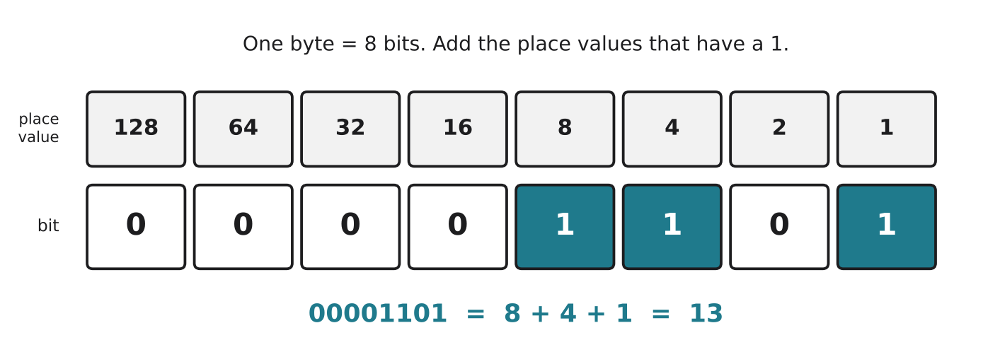
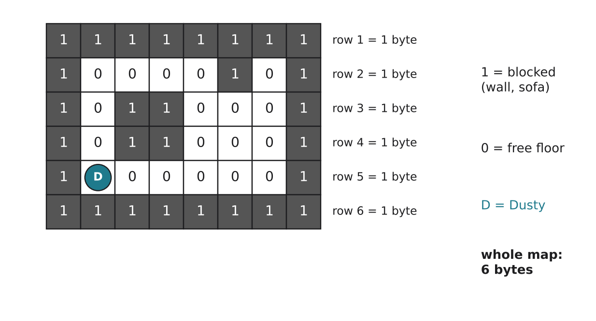

# 1.2 Bits and bytes

Author: Matashev Ariet 1820262363 | Reviewed by: Benslima Khalid 1820262152 | Status: checked

Read first: [1.1 What is a computer?](1-1-what-is-a-computer.md)

## After this section you can

- explain what a bit and a byte are
- turn a small binary number into a normal number, and back
- explain how a computer stores text, and even a map, as numbers
- find and fix a mistake in a binary conversion

## Start with light switches

A light switch has two states: off or on. Let's write off as 0 and on as 1.

- With 1 switch you can make 2 patterns: 0, 1
- With 2 switches you can make 4 patterns: 00, 01, 10, 11
- With 3 switches you can make 8 patterns: 000, 001, 010, 011, 100, 101, 110, 111

Every switch you add doubles the number of patterns.

Inside a computer there are billions of tiny electronic switches, and each one is either off (0) or on (1). Everything a computer stores, from numbers to photos to Dusty's map, is made of these 0s and 1s.

## Words you need

- **Bit** (short for *binary digit*): one 0-or-1 value.
- **Byte:** a group of 8 bits. With 8 bits you get 2 × 2 × 2 × 2 × 2 × 2 × 2 × 2 = 256 different patterns, so one byte can store 256 different values (0 to 255).
- **Binary:** a way of writing numbers using only 0 and 1.
- **Decimal:** the normal way of writing numbers, with the digits 0 to 9.
- **ASCII:** a code that gives each English letter, digit and symbol a number.
- **Unicode:** a much bigger code with a number for almost every character in every language.

## Explanation

### How binary numbers work

In decimal, each place is worth 10 times the one to its right: ones, tens, hundreds. In binary, each place is worth **2 times** the one to its right.

*Figure 1.2.1: Place values in one byte. The rightmost place is worth 1, and each place to the left is worth double. Add the place values that have a 1 under them.*

### How text is stored

A computer can only store 0s and 1s, so text has to be turned into numbers first. Everyone agrees on a code that gives each character a number. The basic code for English letters is **ASCII**:

- "A" is 65, "B" is 66, "C" is 67, and so on up to "Z", which is 90.
- Lowercase "a" is 97.
- Even a space has a number: 32.

So when you type "A", the computer stores 65, which in binary is 01000001.

ASCII only covers English letters, digits and basic symbols. To store Russian, Chinese, Arabic or emoji, computers use **Unicode**. Many of these characters need more than one byte.

### How a map is stored

Dusty (our robot vacuum from 1.1) remembers the room as a grid of squares. Each square is one bit: 1 means blocked (wall, sofa), 0 means free floor. Eight squares in a row fit into exactly one byte.

*Figure 1.2.2: A tiny room map. Each row of 8 squares is one byte, so the whole map takes only 6 bytes. Real robots use much bigger grids, but the idea is the same.*

### How big is a file?

- 1 **kilobyte** (KB) is about a thousand bytes
- 1 **megabyte** (MB) is about a million bytes
- 1 **gigabyte** (GB) is about a billion bytes

(Some computers count 1 KB as 1024 bytes instead of 1000, which is why sizes sometimes look slightly different on different devices.)

## Worked example 1: binary to decimal

What is binary 1101 as a normal number? Write it under the last four place values:

| 8 | 4 | 2 | 1 |
| --- | --- | --- | --- |
| 1 | 1 | 0 | 1 |

Add up the place values that have a 1 under them: 8 + 4 + 1 = 13. So binary 1101 = 13.

## Worked example 2: decimal to binary

How do we write 13 in binary? Go through the place values from the biggest one that fits, and subtract as you go.

1. Does 8 fit into 13? Yes. Write 1. 13 - 8 = 5 left.
2. Does 4 fit into 5? Yes. Write 1. 5 - 4 = 1 left.
3. Does 2 fit into 1? No. Write 0.
4. Does 1 fit into 1? Yes. Write 1. Nothing left.

Answer: 1101. As a full byte, we fill the empty places on the left with zeros: 00001101.

## Worked example 3: reading Dusty's map

Row 2 of the map in Figure 1.2.2 is 10000101. Using the place values 128, 64, 32, 16, 8, 4, 2, 1:

128 + 4 + 1 = 133

So Dusty stores row 2 as the number 133. The computer does not "see" walls; it only keeps this number.

## Try it yourself

**Q1. Convert.** Turn these binary numbers into normal numbers: a) 1010  b) 11111111

**Q2. Convert back.** Turn these numbers into binary: a) 6  b) 20

**Q3. Decode.** Each byte is one ASCII letter. Use the rule "A is 65, B is 66, and so on".

01001000 01001001

**Q4. Explain.** Why can't one byte store the number 300?

**Q5. Find the error.** A student converted 25 to binary like this: "16 fits, 9 left. 8 fits, 1 left. 4 does not fit. 2 does not fit. 1 fits. Answer: 1101." The steps are right, but the answer is wrong. What is the mistake, and what is the correct answer?

**Q6. Map task.** Row 3 of Dusty's map is 10110001. Which number does Dusty store for this row? Then a chair is moved onto the free square right next to the left wall in this row. Write the new row and its number.

## Answers

**Q1.**

a) 1010 = 8 + 2 = **10**

b) 11111111 = 128 + 64 + 32 + 16 + 8 + 4 + 2 + 1 = **255**. This is the biggest number one byte can hold.

**Q2.**

a) 6: 4 fits (6 - 4 = 2 left), 2 fits (0 left), 1 doesn't fit. Answer: **110**

b) 20: 16 fits (20 - 16 = 4 left), 8 doesn't fit, 4 fits (0 left), 2 doesn't fit, 1 doesn't fit. Answer: **10100**

**Q3.** 01001000 = 64 + 8 = 72. 01001001 = 64 + 8 + 1 = 73. Counting from A = 65: 72 is H and 73 is I. The message is **HI**.

**Q4.** The biggest number one byte can hold is 255 (all eight bits set to 1). 300 is bigger than that, so it needs at least 9 bits, which means a computer uses 2 bytes for it.

**Q5.** The student wrote a digit only when a place value fitted and skipped the 0s. The five steps give 1, 1, 0, 0, 1, so the answer is **11001**. Check: 16 + 8 + 1 = 25. Without the zeros, 1101 is 13, a different number.

**Q6.** 10110001 = 128 + 32 + 16 + 1 = **177**. The square right next to the left wall is the second bit from the left (place value 64). It changes from 0 to 1, so the new row is **11110001** = 128 + 64 + 32 + 16 + 1 = **241**.

## Common mistakes

- **Reading the place values from the wrong end.** The rightmost place is always worth 1.
- **Skipping the zeros.** In 10100 the zeros matter: they show which places are empty (see Q5).
- **Mixing up bits and bytes.** 1 byte = 8 bits. Internet speed is usually given in bits per second (Mbps), file size in bytes (MB), so a 100 Mbps connection downloads about 12.5 MB per second, not 100.

## Sources

1. Brookshear, J. G., & Brylow, D. (2019). *Computer Science: An Overview* (13th ed.). Pearson. Chapter 1, "Data Storage".
2. Wikipedia. "ASCII." https://en.wikipedia.org/wiki/ASCII (accessed 5 Nov 2026)

Next: [1.3 The von Neumann architecture](1-3-von-neumann-architecture.md)
