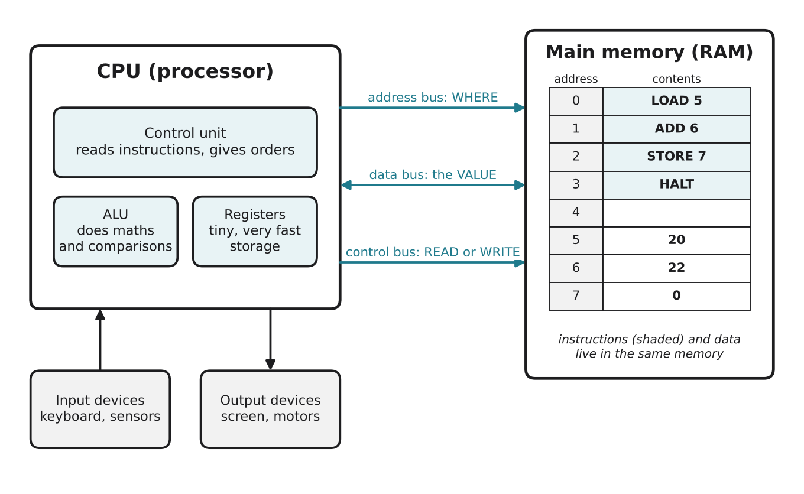

# 1.3 The von Neumann architecture

Author: Matashev Ariet 1820262363 | Reviewed by: Benslima Khalid 1820262152 | Status: checked

Read first: [1.1 What is a computer?](1-1-what-is-a-computer.md) and [1.2 Bits and bytes](1-2-bits-and-bytes.md)

## After this section you can

- name the main parts inside a computer: CPU (control unit, ALU, registers), memory, buses, input and output
- explain the stored-program idea: instructions and data live in the same memory
- describe, step by step, how the CPU reads one number from memory
- decide which part of the computer is responsible for a given job

## Start with an example

In 1.1 your phone calculated 12 + 7. But where exactly did the "+" happen? Where were 12 and 7 kept while the phone worked? And where was the calculator program itself?

Almost every computer today, from Dusty's chip to your laptop, answers these questions in the same way. The design was described in 1945 in a report written by the mathematician John von Neumann, so it is called the **von Neumann architecture**.

## Words you need

- **CPU (central processing unit, the processor):** the part that carries out instructions.
- **Control unit:** the part of the CPU that reads each instruction and gives orders to the other parts.
- **ALU (arithmetic logic unit):** the part of the CPU that does maths (add, subtract) and comparisons (is A bigger than B?).
- **Register:** a tiny, very fast storage place inside the CPU that holds a number it is working on right now.
- **Memory (RAM, main memory):** a long row of numbered boxes. Each box has an **address** and holds a **value**.
- **Bus:** a set of wires that carries signals between the CPU, memory and other parts.
- **Stored-program idea:** programs are stored in memory as numbers, in the same memory as the data.

## Explanation

*Figure 1.3.1: The von Neumann architecture. The CPU and memory are connected by three buses. Input and output devices connect to the CPU. In memory, addresses 0 to 3 hold a small program and addresses 5 to 7 hold data.*

### The parts and their jobs

| Part | Job (from 1.1) | Everyday comparison |
| --- | --- | --- |
| Control unit | processing: reads instructions, gives orders | the head chef reading the recipe |
| ALU | processing: calculates and compares | the cook who chops and mixes |
| Registers | very short-term storage | the cutting board: only what you use right now |
| Memory (RAM) | storage of programs and data | the shelves in the kitchen |
| Buses | carry addresses, values and orders | the paths between the stove and the shelves |
| Input and output devices | input and output | the order slip coming in, the plate going out |

### Memory: addresses and values

Think of memory as a row of lockers. Each locker has a number on the door (the **address**) and something inside (the **value**). In Figure 1.3.1, the locker with address 5 holds the value 20.

Do not mix up the two: address 5 does not mean "the number 5". It means "the locker number 5", which here contains 20.

### The three buses

To use memory, the CPU needs to say three things:

1. **Which locker?** It puts the address on the **address bus**.
2. **Read or write?** It sends the order on the **control bus**.
3. **What value?** The value travels on the **data bus**: from memory to the CPU when reading, from the CPU to memory when writing. This is why the data bus arrow in the figure points both ways.

### The stored-program idea

Look at addresses 0 to 3 in the figure: they hold instructions (LOAD 5, ADD 6, STORE 7, HALT). Addresses 5 to 7 hold ordinary numbers. Both are in the same memory, and inside the computer both are just bytes.

This is the big idea of the von Neumann design. To run a different program, you do not rebuild the machine: you just put different instructions into memory. That is why one phone can be a calculator, a game and a map. (Very early computers had to be rewired by hand for each new task.)

One weakness: instructions and data share the same buses, so the CPU often has to wait for memory. This waiting is called the **von Neumann bottleneck**. Lesson 1.5 shows how computers reduce it with cache.

## Worked example: reading one number from memory

The CPU must load the value at address 5 into a register. Step by step:

1. The control unit puts the address **5** on the address bus.
2. The control unit sends **READ** on the control bus.
3. Memory finds locker 5 and puts its value, **20**, on the data bus.
4. The value 20 arrives in the CPU and is stored in a register.

Now the ALU can use 20 in a calculation. Writing works the same way, except that the CPU sends WRITE and puts the value on the data bus itself.

## Try it yourself

**Q1. Who does it?** Name the part (control unit, ALU, register, memory, bus) that:
a) checks whether 7 is bigger than 3
b) keeps the calculator program while it runs
c) decides that the next instruction is an ADD
d) carries the number 22 from memory to the CPU

**Q2. Trace.** The CPU must **write** the value 42 into address 7. Write the steps, like the worked example, and say which bus is used in each step.

**Q3. Find the error.** "The ALU decides which instruction to run next and also stores the program." Correct this sentence.

**Q4. Address or value?** In Figure 1.3.1, what is the value at address 6? What is at address 3? Is "3" here an address or a value?

**Q5. Explain.** Your friend says: "To make my laptop run a new game, the factory must change its hardware." Use the stored-program idea to explain why this is wrong.

**Q6. Dusty.** Dusty's chip also follows the von Neumann design. Where is Dusty's room map kept, and which bus carries the address of the map square Dusty wants to check?

## Answers

**Q1.** a) ALU (comparison). b) Memory (RAM). c) Control unit. d) The data bus.

**Q2.** 1) The control unit puts address **7** on the address bus. 2) It sends **WRITE** on the control bus. 3) The CPU puts the value **42** on the data bus. 4) Memory stores 42 in locker 7, replacing the old value 0.

**Q3.** The **control unit** decides which instruction comes next. The ALU only does maths and comparisons. The program is stored in **memory**, not in the ALU.

**Q4.** The value at address 6 is 22. Address 3 holds the instruction HALT. "3" here is an address (the locker number), not a value.

**Q5.** A game is software: a list of instructions. Because of the stored-program idea, new instructions are simply loaded into memory and the same hardware runs them. Nothing in the factory changes.

**Q6.** The map is kept in memory (RAM while Dusty is working; a copy can also be saved in long-term storage, see 1.5). Because the map is packed 8 squares per byte (1.2), the CPU puts the address of the **byte** that contains the square on the **address bus**; the whole byte comes back on the data bus, and the CPU then picks out the one bit for that square.

## Common mistakes

- **Mixing up address and value.** Address = which locker. Value = what is inside.
- **Thinking the program lives inside the CPU.** The program is in memory. The CPU fetches one instruction at a time (see 1.4).
- **Thinking registers and RAM are the same.** Registers are a handful of tiny storage places inside the CPU; RAM is outside the CPU and much bigger and slower.

## Sources

1. Brookshear, J. G., & Brylow, D. (2019). *Computer Science: An Overview* (13th ed.). Pearson. Chapter 2, "Data Manipulation".
2. Wikipedia. "Von Neumann architecture." https://en.wikipedia.org/wiki/Von_Neumann_architecture (accessed 5 Nov 2026)
3. von Neumann, J. (1945). *First Draft of a Report on the EDVAC.* Moore School of Electrical Engineering, University of Pennsylvania.

Next: [1.4 The fetch, decode, execute cycle](1-4-fetch-decode-execute.md)
