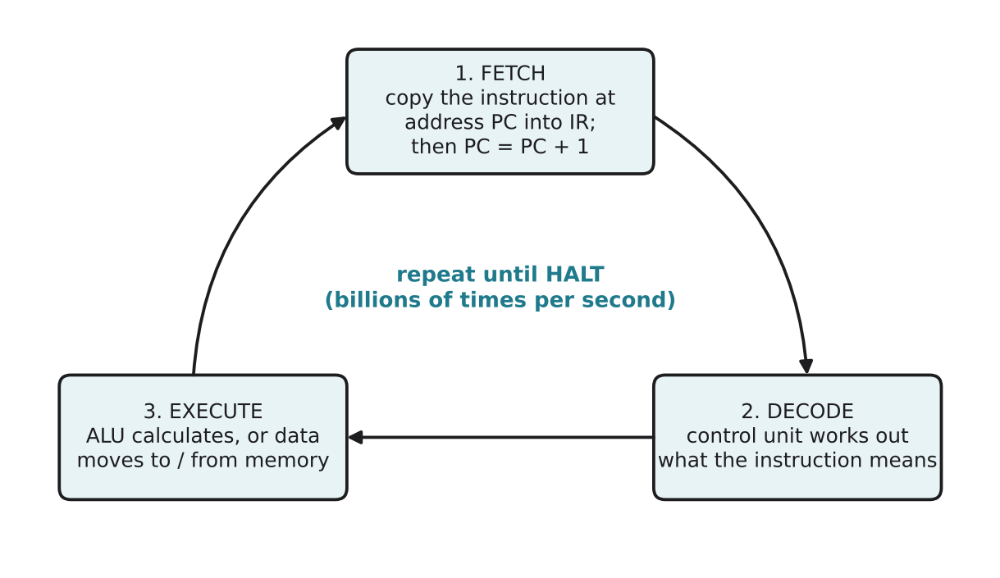

# 1.4 The fetch, decode, execute cycle

Author: Kalbaev Beknazar 1820262361 | Reviewed by: Matashev Ariet 1820262363 | Status: checked

Read first: [1.3 The von Neumann architecture](1-3-von-neumann-architecture.md)

## After this section you can

- name the three stages of the cycle and say what happens in each
- explain what the program counter (PC), instruction register (IR) and accumulator (ACC) do
- trace a short program step by step in a table
- predict the result of a program and find a mistake in someone else's trace

## Start with an example

Imagine you follow a recipe card by card. You pick up the next card (**fetch**), read it and understand what it asks (**decode**), then do it (**execute**). Then you pick up the next card. You never look at the whole recipe at once.

A CPU runs every program in exactly this way, billions of times per second.

## Words you need

- **Instruction:** one small order, such as "load a number" or "add a number".
- **Program counter (PC):** a register that holds the **address** of the next instruction.
- **Instruction register (IR):** a register that holds the instruction being worked on right now.
- **Accumulator (ACC):** a register that holds the result of the latest calculation.
- **Fetch:** copy the next instruction from memory into the IR.
- **Decode:** the control unit works out what the instruction means.
- **Execute:** carry it out (the ALU calculates, or a value moves to or from memory).

## Explanation



*Figure 1.4.1: The cycle. After every execute, the CPU fetches the next instruction, until it reaches HALT.*

We use a tiny made-up CPU with four instructions. Real CPUs have hundreds, but they work the same way.

| Instruction | Meaning |
| --- | --- |
| LOAD a | copy the value at address a into ACC |
| ADD a | add the value at address a to ACC |
| STORE a | copy ACC into address a |
| HALT | stop |

The memory is the same as in Figure 1.3.1 of lesson 1.3:

| Address | 0 | 1 | 2 | 3 | 4 | 5 | 6 | 7 |
| --- | --- | --- | --- | --- | --- | --- | --- | --- |
| Contents | LOAD 5 | ADD 6 | STORE 7 | HALT | (empty) | 20 | 22 | 0 |

Three details matter:

1. During **fetch**, the PC goes up by 1. So the PC always points to the *next* instruction, not the current one.
2. The number after an instruction is an **address**, not a value. ADD 6 means "add what is in locker 6" (22), not "add 6".
3. The CPU never "sees" the whole program. It only knows the PC and one instruction at a time.

## Worked example: tracing the program

The PC starts at 0 and ACC starts at 0.

| Step | PC before | Fetch: IR gets | PC after | Decode | Execute | ACC | Memory change |
| --- | --- | --- | --- | --- | --- | --- | --- |
| 1 | 0 | LOAD 5 | 1 | load from address 5 | ACC = 20 | 20 | none |
| 2 | 1 | ADD 6 | 2 | add value at address 6 | ACC = 20 + 22 | 42 | none |
| 3 | 2 | STORE 7 | 3 | store ACC into address 7 | address 7 = 42 | 42 | address 7: 0 becomes 42 |
| 4 | 3 | HALT | 4 | stop | the program ends | 42 | none |

Result: the program added the numbers in addresses 5 and 6 and saved the answer, 42, in address 7. Four instructions needed four full cycles.

## Try it yourself

**Q1. Predict.** A new program is stored at addresses 0 to 4: LOAD 5, ADD 6, ADD 6, STORE 7, HALT. Address 5 holds 20 and address 6 holds 22. Before tracing, predict the final value at address 7. Then trace it in a table like the worked example.

**Q2. PC check.** In the worked example, what is the value of the PC while the CPU is executing STORE 7? Why is it not 2?

**Q3. Find the error.** Here is a student's trace of step 2 of the worked example:
"Fetch ADD 6. Execute: ACC = 20 + 6 = 26."
What is the mistake? What should ACC be?

**Q4. Write a program.** Using only LOAD, ADD, STORE and HALT, write a program that calculates (value at address 10) + (value at address 11) + (value at address 12) and saves the result in address 13. Start at address 0.

**Q5. Dusty.** Dusty's chip runs the same cycle. Its bump-sensor program checks the bumper about 100 times per second. Explain why Dusty still reacts "instantly", using the fact that a CPU can run millions of cycles per second.

**Q6. Try it on a real simulator (optional).** Little Man Computer (LMC) is a free teaching simulator of a simple CPU. Open https://peterhigginson.co.uk/lmc/ in a browser, delete any code in the editor, type the program below, then press the button that loads it into memory (**Submit**) and then **Run**. When the simulator asks for input, type 20 and press Enter, then 22.

```
        INP
        STA FIRST
        INP
        ADD FIRST
        OUT
        HLT
FIRST   DAT
```

Watch the "Program counter" box change. Which value appears in the OUTPUT box? Which LMC instruction in this program does the same job as our STORE? (LMC is a simplified model for teaching, not a real CPU.)

## Answers

**Q1.** Prediction: 20 + 22 + 22 = **64**.

| Step | PC before | IR | PC after | ACC | Memory change |
| --- | --- | --- | --- | --- | --- |
| 1 | 0 | LOAD 5 | 1 | 20 | none |
| 2 | 1 | ADD 6 | 2 | 42 | none |
| 3 | 2 | ADD 6 | 3 | 64 | none |
| 4 | 3 | STORE 7 | 4 | 64 | address 7 = 64 |
| 5 | 4 | HALT | 5 | 64 | none |

**Q2.** The PC is **3**. The PC goes up by 1 during the fetch of STORE 7, so while STORE 7 is executing, the PC already points to the next instruction (HALT at address 3).

**Q3.** The student treated 6 as a value. ADD 6 means "add the value stored at address 6", which is 22. Correct: ACC = 20 + 22 = **42**.

**Q4.** One correct program:

| Address | Instruction |
| --- | --- |
| 0 | LOAD 10 |
| 1 | ADD 11 |
| 2 | ADD 12 |
| 3 | STORE 13 |
| 4 | HALT |

**Q5.** Each check of the bumper takes only a few instructions. If the chip runs millions of cycles per second, 100 checks per second use a tiny part of its time, and the gap between two checks is only 0.01 seconds. To a human, a reaction within about 0.01 seconds looks instant.

**Q6.** The OUTPUT box shows **42**. The first INP reads 20 and STA FIRST stores it in memory; the second INP puts 22 into the accumulator; ADD FIRST adds the stored 20. **STA** (store accumulator) does the same job as our STORE. (LMC's version of our LOAD is LDA, which this program does not need, because INP already puts the number into the accumulator.)

## Common mistakes

- **Treating the number in an instruction as a value.** In LOAD 5, ADD 6, STORE 7 the numbers are addresses.
- **Forgetting that the PC moves during fetch.** While an instruction executes, the PC already points to the next one.
- **Thinking the CPU reads the whole program at once.** It fetches one instruction per cycle.

## Sources

1. Brookshear, J. G., & Brylow, D. (2019). *Computer Science: An Overview* (13th ed.). Pearson. Chapter 2, "Program Execution".
2. Wikipedia. "Instruction cycle." https://en.wikipedia.org/wiki/Instruction_cycle (accessed 5 Nov 2026)
3. Higginson, P. *Little Man Computer simulator.* https://peterhigginson.co.uk/lmc/ (accessed 5 Nov 2026)

Next: [1.5 The memory hierarchy](1-5-memory-hierarchy.md)
