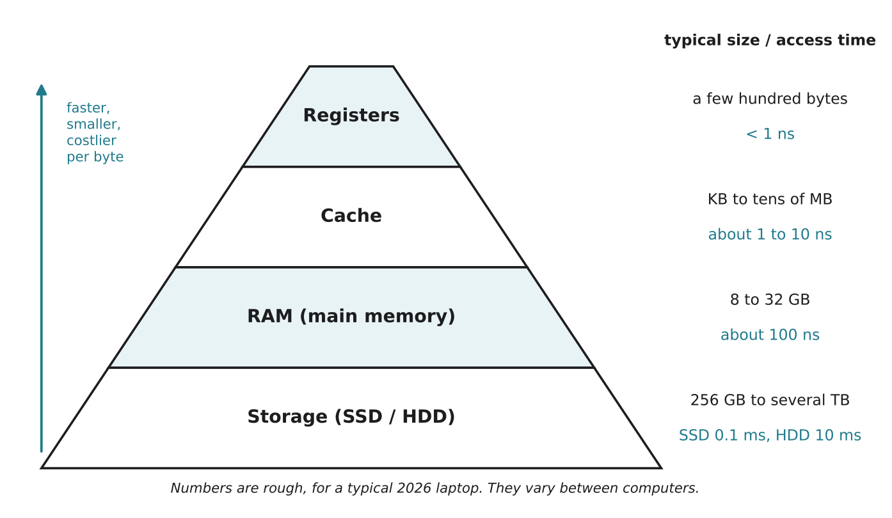

# 1.5 The memory hierarchy

Author: Kalbaev Beknazar 1820262361 | Reviewed by: Matashev Ariet 1820262363 | Status: checked

Read first: [1.3 The von Neumann architecture](1-3-von-neumann-architecture.md) and [1.4 The fetch, decode, execute cycle](1-4-fetch-decode-execute.md)

## After this section you can

- name the four levels of the memory hierarchy: registers, cache, RAM, storage
- compare them by speed, size and price
- explain why computers use several kinds of memory instead of one
- predict where data is when you open and use an app, and what happens when the power goes off

## Start with an example

You start a big game on your laptop. First there is a loading screen for 20 seconds. After that, the game runs smoothly. Why wait at the start? Why not load everything instantly?

Because the game is stored in one kind of memory (the SSD) and must be copied into faster kinds of memory before the CPU can use it quickly.

## Words you need

- **Register:** tiny storage inside the CPU (see 1.3). The fastest of all.
- **Cache:** small, very fast memory on the CPU chip that keeps copies of data the CPU used recently or will probably need soon.
- **RAM (main memory):** the memory that holds the programs and data in use right now.
- **Storage:** long-term memory such as an **SSD** (solid-state drive, made of chips) or an **HDD** (hard disk drive, with a spinning disk).
- **Volatile:** loses its contents when the power goes off (registers, cache, RAM).
- **Non-volatile:** keeps its contents without power (SSD, HDD, USB flash drive).
- **Access time:** how long it takes to get one piece of data.

## Explanation

*Figure 1.5.1: The memory hierarchy. Going up: faster, smaller and more expensive per byte. Going down: bigger, cheaper and slower.*

### Why not use only the fastest memory?

Fast memory is very expensive per byte and uses a lot of space and power on the chip. A computer with 1 TB of cache would cost a fortune. Slow memory is cheap, so we can have a lot of it. The hierarchy gives us the best of both: a small amount of fast memory for what we use right now, and a large amount of cheap memory for everything else.

### How big is the speed difference?

The numbers in nanoseconds (1 ns = one billionth of a second) are hard to imagine. Let's stretch time: pretend that reading from cache takes **1 second**. Then:

| Level | Real access time (approximate) | "Stretched" time |
| --- | --- | --- |
| Cache | about 1 ns | 1 second |
| RAM | about 100 ns | under 2 minutes |
| SSD | about 100,000 ns (0.1 ms) | about 1 day |
| HDD | about 10,000,000 ns (10 ms) | about 4 months |

That is why the CPU tries hard to find data in cache first. When data the CPU needs is already in cache, this is called a **cache hit**; when it is not and the CPU has to wait for RAM, it is a **cache miss**. Cache is the main way computers reduce the von Neumann bottleneck from 1.3.

### A kitchen comparison

- **Registers** = the cutting board: only what you are chopping right now.
- **Cache** = the counter next to you: things you will use in a minute.
- **RAM** = the fridge: today's ingredients, a few steps away.
- **Storage** = the supermarket: everything, but a long trip away. And it is the only one that is still full in the morning: the counter and fridge are "cleared" when the power goes off.

(The comparison has limits: the fridge does not really empty itself at night, but RAM does.)

## Worked example: playing a game

1. The game is installed on the **SSD** (non-volatile, so it stays there when the laptop is off).
2. You start it. During the loading screen, the files for the first level are copied from the SSD into **RAM**.
3. While you play, the parts of the level the CPU is using right now (your character's position, nearby enemies) are copied into **cache**.
4. The numbers the CPU is adding at this exact moment (for example your health minus damage) sit in **registers**.
5. You save the game: your progress is written from RAM back to the SSD. If the power went off before saving, the progress in RAM would be lost.

## Try it yourself

**Q1. Order.** Put these in order from fastest to slowest: RAM, HDD, register, SSD, cache.

**Q2. Predict.** You are writing an essay and have not pressed Save. The power goes off. Which part of your essay is lost, and why? Use the words volatile and non-volatile.

**Q3. Compare.** Laptop A has 8 GB of RAM and laptop B has 32 GB. Both have the same CPU. You open 40 browser tabs and a video editor. Which laptop is likely to feel faster, and why? (Hint: what happens when RAM is full?)

**Q4. Find the error.** "My phone has 256 GB of memory, so it can keep 256 GB of apps open at the same time." What is mixed up here?

**Q5. Dusty.** Dusty has a small amount of RAM and some flash storage (like a tiny SSD). Where should Dusty keep: a) the map of your flat, so it is still there tomorrow; b) the reading from the bump sensor that it is checking right now? Explain.

**Q6. Use the stretched times.** If a cache read took 1 second, roughly how many cache reads could the CPU do in the time of one HDD read? Use the table.

## Answers

**Q1.** register, cache, RAM, SSD, HDD.

**Q2.** Everything typed since the last save is lost. Unsaved text exists only in RAM, which is **volatile** and loses its contents without power. The last saved version is safe on the SSD, which is **non-volatile**.

**Q3.** Laptop B. With 8 GB, RAM fills up and the computer must keep moving data between RAM and the much slower SSD (this is called swapping), so everything slows down. With 32 GB, everything fits in RAM.

**Q4.** The 256 GB is **storage** (the phone's flash memory), not RAM. Apps are kept in storage, but only the ones running right now are in RAM, and phones usually have about 6 to 16 GB of RAM.

**Q5.** a) In flash **storage**, because it is non-volatile: the map survives when Dusty is switched off or the battery runs out. b) In a **register** (or RAM), because the value is used right now and changes every fraction of a second; there is no need to keep it after the power goes off.

**Q6.** HDD: about 4 months; cache: 1 second. Four months is about 10,000,000 seconds (the real ratio is 10 ms ÷ 1 ns = 10,000,000). So roughly **10 million** cache reads in the time of one HDD read.

## Common mistakes

- **Calling storage "memory".** In everyday speech "my phone has 256 GB of memory" means storage. In computer science, memory usually means RAM.
- **Thinking bigger is always faster.** In the hierarchy, bigger levels are slower.
- **Forgetting that RAM is volatile.** Unsaved work in RAM disappears when the power goes off.

## Sources

1. Brookshear, J. G., & Brylow, D. (2019). *Computer Science: An Overview* (13th ed.). Pearson. Chapter 1, "Main Memory" and "Mass Storage".
2. Patterson, D. A., & Hennessy, J. L. (2017). *Computer Organization and Design: The Hardware/Software Interface, RISC-V Edition.* Morgan Kaufmann. Chapter 5, "Large and Fast: Exploiting Memory Hierarchy".
3. Wikipedia. "Memory hierarchy." https://en.wikipedia.org/wiki/Memory_hierarchy (accessed 5 Nov 2026)

Next: [1.6 What makes a computer fast?](1-6-what-makes-a-computer-fast.md)
