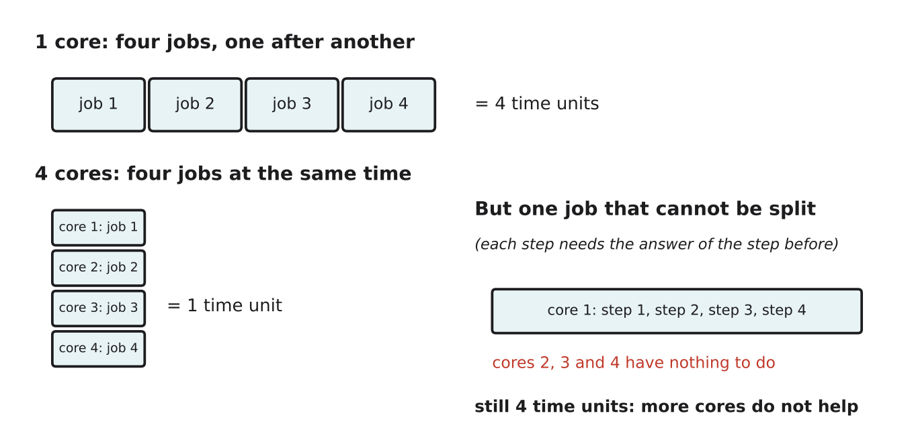

# 1.6 What makes a computer fast?

Author: Kalbaev Beknazar 1820262361 | Reviewed by: Benslima Khalid 1820262152 | Status: checked

Read first: [1.4 The fetch, decode, execute cycle](1-4-fetch-decode-execute.md) and [1.5 The memory hierarchy](1-5-memory-hierarchy.md)

## After this section you can

- explain what clock speed (GHz), cores and cache mean
- calculate how many cycles a CPU runs in a given time
- explain why more cores do not always make a program faster
- choose a suitable CPU for a task and justify the choice

## Start with an example

Two laptops are on sale:

- CPU A: **4.0 GHz**, **2 cores**
- CPU B: **3.0 GHz**, **8 cores**

Which one is faster? The honest answer is: **it depends on what you do with it**. By the end of this lesson you will be able to say when A wins and when B wins.

## Words you need

- **Clock:** a signal inside the CPU that ticks at a steady rate. Each tick lets the CPU take one more small step of work.
- **Clock speed:** how many ticks per second, measured in **hertz (Hz)**. 1 GHz (gigahertz) = 1 billion ticks per second.
- **Core:** one complete processing unit inside the CPU, able to run its own fetch, decode, execute cycle (1.4). A CPU with 8 cores is like 8 CPUs on one chip.
- **Parallel:** done at the same time on different cores.
- **Pipelining:** starting to fetch the next instruction while the current one is still being decoded or executed, like an assembly line.

## Explanation

### 1. Clock speed

A 3 GHz CPU ticks 3 billion times per second. One tick lasts 1 ÷ 3,000,000,000 seconds, which is about 0.33 nanoseconds. In general, a higher clock speed means more steps per second, but only when you compare CPUs of the **same design**. Different designs need different numbers of ticks per instruction, so a 3 GHz CPU of a newer design can beat a 3.5 GHz CPU of an older one.

### 2. Cores

*Figure 1.6.1: Four separate jobs finish four times sooner on four cores. A job made of steps that each need the previous answer cannot be shared between cores.*

More cores help when the work can be **split into independent parts**: exporting a video (each core takes different frames), running many browser tabs, compiling a big program. They do not help when every step needs the answer of the step before. Think of cooking: 8 cooks can prepare 8 salads at once, but 8 cooks cannot boil one egg faster.

### 3. Cache

From 1.5: if the data is not in cache, the CPU waits for RAM, and a fast clock is wasted on waiting. A bigger cache means more cache hits and less waiting.

### 4. Pipelining (introduced briefly)

Instead of finishing fetch, decode and execute for one instruction before starting the next, modern CPUs overlap them: while instruction 1 is executing, instruction 2 is being decoded and instruction 3 is being fetched. Like a laundry where the washer, dryer and folding table all work at the same time on different loads.

## Worked example: CPU A or CPU B?

**Counting cycles.** In one second:

- CPU A: 4.0 billion ticks per core × 2 cores = 8 billion ticks in total
- CPU B: 3.0 billion ticks per core × 8 cores = 24 billion ticks in total

(Assume both CPUs have the same design, so a tick does the same amount of work.)

**Task 1: an old game that uses only one core.** Only one core works, so only the speed of one core matters: A has 4.0 billion ticks per second, B has 3.0 billion. **CPU A wins**, by about a third.

**Task 2: exporting a video, which can use all cores.** A has 8 billion ticks per second in total, B has 24 billion. **CPU B wins**, about 3 times faster.

Conclusion: for one-core tasks the clock speed of one core matters; for tasks that can be split, the total over all cores matters.

## Try it yourself

**Q1. Calculate.** A CPU runs at 2.5 GHz. How many clock ticks does it make in 2 seconds?

**Q2. Choose and justify.** You will mainly do three things: edit long 4K videos, run 3D rendering overnight, and browse the web. Choose between CPU A and CPU B above and explain your choice.

**Q3. Find the error.** "A 3.2 GHz phone CPU is always faster than a 3.0 GHz laptop CPU, because 3.2 is bigger than 3.0." What is wrong with this claim?

**Q4. Predict.** A program adds up a list of 1,000,000 numbers. A programmer splits the list into 4 parts and lets 4 cores add one part each, then adds the 4 partial results. Is this faster than one core? Is it exactly 4 times faster? Explain.

**Q5. Dusty.** Suppose Dusty's main chip runs at only 0.2 GHz and has one core (simple robot vacuums use small, slow chips like this). Is that a problem for its job? Use what you know about how often it needs to check its sensors (see 1.4, Q5).

## Answers

**Q1.** 2.5 GHz = 2,500,000,000 ticks per second. In 2 seconds: 2 × 2,500,000,000 = **5,000,000,000** (5 billion) ticks.

**Q2.** **CPU B.** Video editing and 3D rendering can be split across many cores, and B has 24 billion ticks per second in total against A's 8 billion. Browsing is light work, and both CPUs handle it easily.

**Q3.** Clock speed can only be compared between CPUs of the same design. A phone CPU and a laptop CPU usually have different designs, different numbers of cores, different cache sizes and different power limits. GHz alone does not decide which is faster.

**Q4.** Yes, it is faster, because the four parts are independent and can be added in parallel. But it is a bit **less than 4 times** faster: the computer must split the list, start the four jobs and, at the end, add the four partial results, which takes extra time.

**Q5.** No. Checking a few sensors 100 times per second needs only a small number of instructions. 0.2 GHz is 200 million ticks per second, far more than enough. A slow, simple chip is also cheaper and uses less battery, which matters more for a robot vacuum.

## Common mistakes

- **Comparing GHz across different CPU designs.** It only works within the same design.
- **Thinking 8 cores always means 8 times faster.** Only work that can be split benefits, and there is always some extra time for splitting and combining.
- **Ignoring memory.** A fast CPU that keeps waiting for RAM is not fast in practice.

## Sources

1. Patterson, D. A., & Hennessy, J. L. (2017). *Computer Organization and Design: The Hardware/Software Interface, RISC-V Edition.* Morgan Kaufmann. Chapter 1, "Performance".
2. Brookshear, J. G., & Brylow, D. (2019). *Computer Science: An Overview* (13th ed.). Pearson. Chapter 2, "Other Architectures".
3. Wikipedia. "Multi-core processor." https://en.wikipedia.org/wiki/Multi-core_processor (accessed 5 Nov 2026)

Next: [1.7 Hardware for AI and robots](1-7-hardware-for-ai-and-robots.md)
