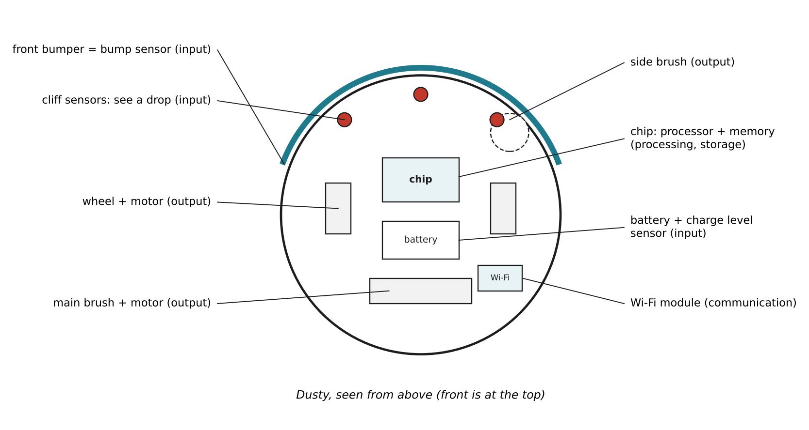

# 1.7 Hardware for AI and robots

Author: Kalbaev Beknazar 1820262361 | Reviewed by: Mussaldinov Rassul 1820262146 | Status: checked

Read first: [1.1 What is a computer?](1-1-what-is-a-computer.md) and [1.6 What makes a computer fast?](1-6-what-makes-a-computer-fast.md)

## After this section you can

- explain what sensors and actuators are and give examples
- explain why GPUs are used for training AI
- list the main parts of a robot vacuum and say which of the four jobs each part does
- choose the hardware needed for a new robot behavior

## Start with an example

Turn Dusty upside down (gently). You will see small windows near the front edge, two wheels, a brush roll and metal contacts for charging. None of these look like a laptop, but together with a small chip they make a complete computer that can move.

*Figure 1.7.1: Dusty's main parts. Sensors (inputs) are around the edge and underneath, motors (outputs) drive the wheels and brushes, and the chip in the middle does the processing and storage.*

## Words you need

- **Sensor:** a part that measures something in the world and turns it into a number for the computer (an input device).
- **Actuator:** a part that makes something happen in the world, usually a motor (an output device).
- **Microcontroller:** a small, cheap computer on one chip (CPU, memory and input/output pins together), made for controlling devices.
- **GPU (graphics processing unit):** a processor with thousands of small, simple cores that do the same kind of calculation on many numbers at once.
- **Encoder:** a sensor that counts how far a wheel has turned.

## Explanation

### Sensors: how a robot gets input

| Sensor | What it measures | How Dusty uses it |
| --- | --- | --- |
| Bump sensor (switch behind the bumper) | pressed or not pressed | "I hit something" |
| Cliff sensor (infrared light pointing down) | how much light bounces back from the floor | little light back = no floor = stairs |
| Wheel encoder | how far each wheel turned | estimate distance and position |
| Battery sensor | battery charge level | decide when to go home |
| Dirt sensor (in some models) | how much dirt hits the brush area | clean longer in dirty spots |
| Lidar or camera (in more expensive models) | distances to walls, or images | build a detailed map |

### Actuators: how a robot gives output

Dusty has motors for the two wheels, the main brush, the side brush and the suction fan, plus a speaker and lights. Each motor is an output device controlled by the chip.

### The chip: processing and storage

A simple robot vacuum uses a **microcontroller**: CPU, memory and connections for sensors and motors on one small chip. More advanced models add a bigger processor to handle lidar or camera data. Either way, it follows the von Neumann design from 1.3.

### GPUs: hardware for training AI

Modern AI systems, such as the neural networks behind face unlock and chatbots, are trained by doing the same simple calculation (multiply, then add) on millions or billions of numbers. A CPU has a few powerful cores; a GPU has **thousands of small cores** that all work in parallel (remember the cores idea from 1.6). This makes GPUs much faster for this kind of work. GPUs were first built to draw computer graphics, where millions of pixels need the same calculation, which is why they are called graphics processing units.

Dusty does not need a big GPU: its behavior is based on simple rules (Part 3), not a giant neural network. Training AI usually happens on large GPU computers in data centers, and the trained result can then run on smaller devices.

## Worked example: Dusty's parts list

| Part | Type | Job (from 1.1) |
| --- | --- | --- |
| Front bumper with switch | sensor | input |
| 3 cliff sensors underneath | sensor | input |
| Battery level sensor | sensor | input |
| Chip (microcontroller) | processor + memory | processing and storage |
| Flash memory with the room map | storage | storage |
| 2 wheel motors | actuator | output |
| Brush and suction motors | actuator | output |
| Wi-Fi module | communication | input and output (sends and receives messages, see Part 2) |

## Try it yourself

**Q1. Sort.** Sensor or actuator? a) a microphone in a smart speaker b) the motor that opens a car window c) a thermometer in a thermostat d) a speaker e) a camera in a self-driving car

**Q2. Design.** You want Dusty to clean carpets more strongly: when it drives onto a carpet, the suction fan should spin faster. Which new sensor does Dusty need, which actuator does the action, and what rule connects them?

**Q3. Explain.** Why is a GPU faster than a CPU for training a neural network, but not necessarily faster for running a word processor?

**Q4. Predict.** One of Dusty's cliff sensors is covered by dust and always "sees" the floor. What could happen near the stairs? What does this tell you about sensors?

**Q5. Find the error.** "A robot vacuum is not a computer, because it has no screen and no keyboard." Correct this using the words sensor and actuator.

## Answers

**Q1.** a) sensor b) actuator c) sensor d) actuator (it produces sound, an output) e) sensor

**Q2.** Sensor: a **carpet sensor** (for example, an infrared sensor that notices the floor surface change, or a sensor that notices the brush motor working harder on carpet). Actuator: the **suction fan motor**. Rule: IF the carpet sensor says "carpet" THEN set the fan to high power, ELSE normal power. (Part 3 calls rules like this behaviors.)

**Q3.** Training a neural network is the same simple calculation repeated on huge numbers of values, which can be split across thousands of small GPU cores. A word processor mostly does one thing after another (respond to a key, update the page), so it cannot use thousands of cores, and a CPU core, which is faster on its own, does better.

**Q4.** The sensor never reports "no floor", so Dusty does not stop at the edge and could fall down the stairs. The robot can only react to what its sensors report: if the input is wrong, a correct program still makes a wrong decision. This is why robots often have several cliff sensors and why sensors need cleaning.

**Q5.** A computer does not need a screen or keyboard. Dusty takes input through **sensors** (bumper, cliff, battery), processes it on its chip, stores a map, and produces output through **actuators** (wheel and brush motors). It does all four jobs, so it is a computer.

## Common mistakes

- **Thinking input means only keyboard and mouse.** For robots, the main inputs are sensors.
- **Thinking every AI device needs a powerful GPU.** Training big models does; a robot running simple rules does not.
- **Trusting sensors blindly.** Dust, light and dark carpets can fool sensors (dark carpets sometimes look like a cliff to infrared sensors).

## Sources

1. Russell, S., & Norvig, P. (2021). *Artificial Intelligence: A Modern Approach* (4th ed.). Pearson. Chapter 26, "Robotics" (robot hardware: sensors and effectors).
2. Wikipedia. "Robotic vacuum cleaner." https://en.wikipedia.org/wiki/Robotic_vacuum_cleaner (accessed 5 Nov 2026)
3. Wikipedia. "Graphics processing unit." https://en.wikipedia.org/wiki/Graphics_processing_unit (accessed 5 Nov 2026)

Next: Part 2 begins with [2.1 What is a network?](../2-NETWORKS/2-1-what-is-a-network.md)
