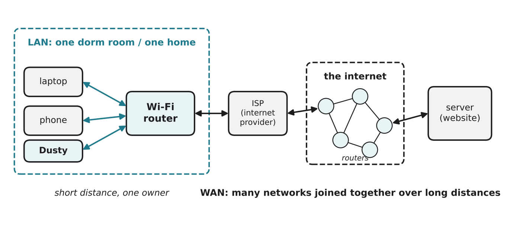

# 2.1 What is a network?

Author: Karbuzov Sanzhar 1820262137 | Reviewed by: Ali Ahmed 1820262072 | Status: checked

Read first: Part 1, especially [1.1 What is a computer?](../1-HARDWARE/1-1-what-is-a-computer.md)

## After this section you can

- explain what a computer network is and why we build them
- tell the difference between a LAN and a WAN
- explain what a switch and a router do
- trace the path from a device in your dorm to a website

## Start with an example

You are in a classroom, Dusty is at home, and you tap "Start cleaning" in the app. Two seconds later Dusty starts moving. Your phone and Dusty are in different places and are not connected by any cable. How did the message get there?

Part 1 looked inside one computer. Part 2 is about how computers talk to each other.

## Words you need

- **Network:** two or more devices connected so they can send data to each other.
- **LAN (local area network):** a network in a small area with one owner: a home, a dorm, an office.
- **WAN (wide area network):** a network that covers a large area by joining many networks together. The internet is the biggest WAN.
- **Switch:** a device that connects devices **inside one LAN** and passes each message only to the device it is for.
- **Router:** a device that connects **different networks** and forwards data from one network towards another.
- **ISP (internet service provider):** the company that connects your home or campus to the internet (for example China Mobile or China Telecom).
- **Server:** a computer that provides a service to other computers, such as a website.

## Explanation

### Why networks?

Networks let devices share information (messages, photos, websites) and resources (one printer for a whole office, one internet connection for a whole family). Without a network, Dusty could not receive your "Start" from the classroom.

### LAN and WAN

*Figure 2.1.1: Your laptop, phone and Dusty are in one LAN. The Wi-Fi router connects the LAN, through your ISP, to the internet (a WAN made of many routers) and on to the website's server.*

| | LAN | WAN |
| --- | --- | --- |
| Area | one room, home, building or campus | a city, a country, the world |
| Owner | one person or organization | many owners (ISPs, companies) |
| Example | your dorm Wi-Fi | the internet |

### Switches and routers

- A **switch** works inside one LAN. It learns which device is connected to which of its ports and sends each message only to the right device.
- A **router** sits between networks. When data needs to leave your LAN, the router forwards it to the next network on the way, like a post office passing letters to the next post office.

The box at home that people call a "Wi-Fi router" is usually several devices in one: a router, a small switch, and a wireless access point (which lets devices join by Wi-Fi instead of a cable).

## Worked example: from your dorm to a website

You open a website on your laptop in the dorm:

1. Your laptop sends the request by Wi-Fi to the dorm's access point and router. (inside the LAN)
2. The router sees that the website is not in the LAN, so it forwards the request to the campus network or your ISP.
3. The ISP passes it to the internet, where routers forward it from network to network.
4. The request reaches the website's **server**, which sends the page back along a similar path.

Each router only needs to know the next step, not the whole route, just as a post office does not need to know every street in another country.

## Try it yourself

**Q1. LAN or WAN?** a) a home Wi-Fi network b) the internet c) the network of all computers in one office floor d) a bank's network connecting branches in 30 cities

**Q2. Switch or router?** a) It connects the 20 computers in a computer lab with cables. b) It connects your home network to your ISP. c) It decides where to send data that is going to another country.

**Q3. Trace.** Your phone is on 4G (not on home Wi-Fi). You tap "Start" in the Dusty app. Describe the path of the message from your phone to Dusty. Which LAN is involved, and where does the WAN come in?

**Q4. Predict.** The home router is switched off. Can your phone (on 4G, in the classroom) still start Dusty? Can your laptop at home still open a file stored on another computer in the same flat by Wi-Fi? Explain both.

**Q5. Find the error.** "The internet and my Wi-Fi are the same thing." Explain what is wrong.

## Answers

**Q1.** a) LAN b) WAN c) LAN d) WAN

**Q2.** a) switch (devices inside one LAN) b) router (between two networks) c) router (forwarding between networks)

**Q3.** Phone → mobile network (4G) of your provider → internet (WAN) → usually a server of the robot company (see 4.1) → internet → your home ISP → home router → Wi-Fi (LAN) → Dusty. The only LAN is your home network at the end; everything between your phone and your home router is WAN.

**Q4.** No and no. Dusty can only be reached through the home router, so the message from 4G has nowhere to go. And at home, the "Wi-Fi router" box is also the wireless access point and switch, so without it the devices in the flat cannot reach each other by Wi-Fi either.

**Q5.** Wi-Fi is just a way to connect devices to a LAN without cables. The internet is a worldwide WAN of millions of networks. Your Wi-Fi is the first step: your router connects it to the internet. You can have Wi-Fi without internet (for example when the ISP has a problem).

## Common mistakes

- **Mixing up Wi-Fi and the internet.** Wi-Fi is local and wireless; the internet is global.
- **Thinking one router knows the whole route.** Each router only forwards data one step closer.
- **Thinking switches and routers do the same thing.** Switches connect devices in one network; routers connect networks.

## Sources

1. Kurose, J. F., & Ross, K. W. (2021). *Computer Networking: A Top-Down Approach* (8th ed.). Pearson. Chapter 1, "Computer Networks and the Internet".
2. Cloudflare Learning Center. "What is a LAN?" https://www.cloudflare.com/learning/network-layer/what-is-a-lan/ (accessed 5 Nov 2026)

Next: [2.2 Packets](2-2-packets.md)
