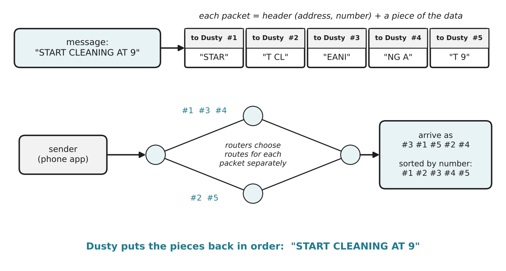

# 2.2 Packets

Author: Karbuzov Sanzhar 1820262137 | Reviewed by: Ali Ahmed 1820262072 | Status: checked

Read first: [2.1 What is a network?](2-1-what-is-a-network.md)

## After this section you can

- explain why data is split into packets
- name what a packet header contains
- explain packet switching and compare it with circuit switching
- put out-of-order packets back together and predict what happens when one is lost

## Start with an example

You send a 3 MB photo to a friend. It does not travel as one big piece. It is cut into roughly two thousand small pieces, each one travels on its own, and your friend's phone glues them back together. Why go to all this trouble?

## Words you need

- **Packet:** a small piece of data sent across a network, with a label attached.
- **Header:** the label at the front of a packet: where it comes from, where it goes, and its number in the sequence.
- **Payload:** the actual piece of data inside the packet.
- **Sequence number:** the packet's position in the original message (#1, #2, #3 ...).
- **Packet switching:** sending data as separate packets that share the network with everyone else's packets.
- **Circuit switching:** reserving one fixed path for the whole conversation (how old telephone networks worked).

## Explanation

### Why packets?

1. **Sharing.** Thousands of people use the same cables. Small packets from everyone can take turns, like many small cars on a road, instead of one giant truck blocking it.
2. **Fixing errors.** If something goes wrong, only one small packet must be sent again, not the whole file.
3. **Finding a way.** If one router fails, the next packets can simply take a different route.

On most networks one packet carries at most about **1,500 bytes**. (Remember from 1.2: a byte is 8 bits.)

### What is in a packet

*Figure 2.2.1: The message "START CLEANING AT 9" is split into 5 packets. Each has a header (where it goes and its number) and a payload (4 characters). The packets take different routes, arrive in a different order, and are sorted by number at the end.*

A real header also contains the sender's address (so the answer can come back) and a check value that lets the receiver notice if the packet was damaged on the way.

### Packet switching vs circuit switching

| | Circuit switching (old phone calls) | Packet switching (internet) |
| --- | --- | --- |
| Path | one fixed path reserved for the whole call | each packet can take a different path |
| Sharing | the path is blocked for others, even during silence | the cables are shared by everyone's packets |
| If a link breaks | the call drops | packets go around the problem |
| Order | always in order | can arrive out of order, so they are numbered |

## Worked example: how many packets?

Suppose each packet can carry **1,000 bytes** of data (to keep the numbers simple). Dusty uploads a small map file of **4,500 bytes**.

- 4,500 ÷ 1,000 = 4.5, so Dusty needs **5 packets**.
- Packets #1 to #4 each carry 1,000 bytes; packet #5 carries the last 500 bytes.
- Each packet also has its own header, so a bit more than 4,500 bytes actually travel across the network.

## Try it yourself

**Q1. Rebuild.** Dusty receives these packets in this order. Each payload is 4 characters (a space counts as a character). Put them in order and read the message.

| Arrived | Sequence number | Payload |
| --- | --- | --- |
| 1st | #4 | "AT 2" |
| 2nd | #2 | "ITCH" |
| 3rd | #5 | "0%  " |
| 4th | #1 | "GO K" |
| 5th | #3 | "EN, " |

**Q2. Calculate.** With 1,000 bytes per packet, how many packets does a 12,300-byte file need? How many bytes are in the last packet?

**Q3. Predict.** In Q1, packet #3 never arrives. What can Dusty still understand? Why would it be dangerous to just "skip" the missing piece in a command for a robot? (Lesson 2.5 shows how TCP fixes this.)

**Q4. Compare.** Explain why a phone call that keeps a whole line reserved for 10 minutes uses the network less efficiently than packet switching, even if both people are silent half the time.

**Q5. Find the error.** "All packets of one file must travel on exactly the same route, otherwise the file is broken." Correct this.

## Answers

**Q1.** In order #1 to #5: "GO K" + "ITCH" + "EN, " + "AT 2" + "0%  " = **"GO KITCHEN, AT 20%"**. (The last packet was padded with two spaces.) Perhaps a command meaning "go to the kitchen when the battery is at 20%".

**Q2.** 12,300 ÷ 1,000 = 12.3, so **13 packets**. Packets #1 to #12 carry 1,000 bytes each (12,000 bytes); the last one carries **300 bytes**.

**Q3.** Dusty gets "GO KITCH" ... "AT 20%" with a gap: it cannot be sure where to go. If a robot guessed missing parts of a command, it could do something wrong or unsafe, so commands must arrive complete. The receiver should ask for packet #3 again.

**Q4.** With circuit switching the reserved line carries nothing during the silences, but nobody else can use it. With packet switching, packets are only sent when there is something to send, and the gaps are used by other people's packets.

**Q5.** Packets of one file can take **different routes** and arrive out of order. The file is not broken, because each packet has a sequence number and the receiver puts them back in order.

## Common mistakes

- **Thinking a file travels in one piece.** It is always split into packets.
- **Thinking packets arrive in order.** They often do, but not always; sequence numbers fix this.
- **Forgetting the header.** Every packet carries extra bytes for its label.

## Sources

1. Kurose, J. F., & Ross, K. W. (2021). *Computer Networking: A Top-Down Approach* (8th ed.). Pearson. Section 1.3, "The Network Core" (packet switching vs circuit switching).
2. Wikipedia. "Packet switching." https://en.wikipedia.org/wiki/Packet_switching (accessed 5 Nov 2026)

Next: [2.3 IP addresses](2-3-ip-addresses.md)
