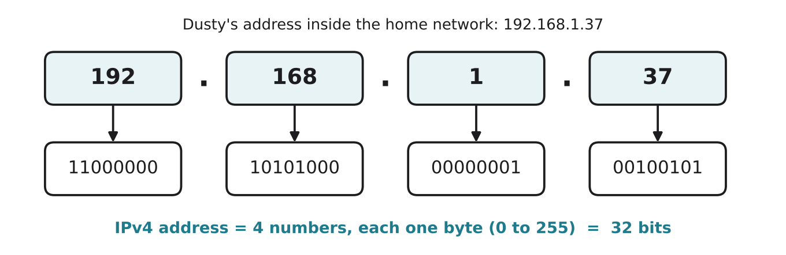

# 2.3 IP addresses

Author: Karbuzov Sanzhar 1820262137 | Reviewed by: Benslima Khalid 1820262152 | Status: checked

Read first: [1.2 Bits and bytes](../1-HARDWARE/1-2-bits-and-bytes.md) and [2.2 Packets](2-2-packets.md)

## After this section you can

- explain what an IP address is and why every packet needs one
- check whether an IPv4 address is valid, using what you know about bytes
- explain why IPv6 was needed
- tell IP addresses, MAC addresses and ports apart

## Start with an example

Every packet from 2.2 has "to" and "from" written in its header. But what exactly is written there? Not "Dusty" or "Rassul's phone". Computers use numbers. Dusty's address in its home network might be:

**192.168.1.37**

## Words you need

- **IP address:** a number that identifies a device on a network, so packets can be delivered to it. IP stands for Internet Protocol.
- **IPv4:** the older and still most common version: four numbers from 0 to 255 separated by dots.
- **IPv6:** the newer version with much longer addresses.
- **Public IP address:** an address that is unique on the whole internet.
- **Private IP address:** an address used only inside one LAN, such as 192.168.x.x. Many homes use the same private addresses.
- **MAC address:** a hardware address built into each network card, used to deliver data inside one LAN.
- **Port:** a number that says which program on a device should receive the data (for example 443 for secure websites).

## Explanation

### IPv4: four bytes

*Figure 2.3.1: Each of the four numbers in an IPv4 address is stored in one byte, so the whole address is 32 bits.*

Because each part is one byte, each part can only be **0 to 255** (lesson 1.2: one byte holds 256 values). An address like 192.168.300.1 is impossible.

With 32 bits there are 2 × 2 × ... × 2 (32 times) = 2^32 = **4,294,967,296** different addresses, about 4.3 billion. That sounded like a lot in the 1980s, but today there are far more phones, laptops, cameras and robot vacuums than that. IPv4 addresses ran out.

### Two solutions to running out

1. **Private addresses and sharing.** Inside your home, devices get private addresses such as 192.168.1.37. The router has one public address and shares it with all of them, keeping track of which reply belongs to which device. (This sharing is called NAT, network address translation.) That is why millions of homes can all use 192.168.1.x without problems.
2. **IPv6.** IPv6 addresses have **128 bits**, written as eight groups of hexadecimal digits, for example `2001:db8:85a3::8a2e:370:7334`. That is about 3.4 × 10^38 addresses, enough to give every grain of sand on Earth many addresses.

### IP address, MAC address and port

| | IP address | MAC address | Port |
| --- | --- | --- | --- |
| Identifies | a device on a network | a network card | a program on a device |
| Example | 192.168.1.37 | 3C:22:FB:9A:10:04 | 443 |
| Used for | getting packets across networks | the last step inside one LAN | handing data to the right app |
| Comparison | the address of a building | the name on a mailbox in that building | the room number |

The comparison is not perfect, but it shows the idea: you need the building (IP) to get there across the city, the mailbox (MAC) in the hallway, and the room (port) for the right person.

## Worked example: is it a valid IPv4 address?

Check three rules: exactly **4 parts**, separated by dots, and each part a whole number from **0 to 255**.

- `10.0.0.1`: 4 parts, all between 0 and 255. **Valid.**
- `192.168.256.1`: the third part is 256, more than one byte can hold. **Invalid.**
- `172.16.5`: only 3 parts. **Invalid.**

## Try it yourself

**Q1. Valid or invalid?** Explain each answer.
a) 8.8.8.8  b) 192.168.1.300  c) 255.255.255.255  d) 10.20.30  e) 172.16.0.-1

**Q2. Convert.** Write the IPv4 address 10.0.1.255 as four bytes in binary.

**Q3. Explain.** Your friend's home and your home both have a device with the address 192.168.1.5. Why does this not cause a problem on the internet?

**Q4. Which address?** a) The router must deliver a packet to Dusty's Wi-Fi card inside the flat. b) A packet must travel from a server in Shanghai to your home. c) Your laptop receives data for both the browser and a game at the same time. Which of IP address, MAC address or port solves each problem?

**Q5. Find the error.** "IPv6 addresses are just IPv4 addresses with two more numbers, like 192.168.1.37.5.6." What is wrong?

## Answers

**Q1.**
a) **Valid**: 4 parts, each 0 to 255.
b) **Invalid**: 300 is bigger than 255.
c) **Valid**: 255 is the largest value one byte can hold (all bits 1).
d) **Invalid**: only 3 parts.
e) **Invalid**: negative numbers are not allowed.

**Q2.** 10 = 00001010, 0 = 00000000, 1 = 00000001, 255 = 11111111. So: **00001010.00000000.00000001.11111111**.

**Q3.** 192.168.1.5 is a **private** address, used only inside each home LAN. On the internet, each home appears with its router's **public** address, which is different. The routers translate between the private and public addresses (NAT).

**Q4.** a) MAC address (the last step inside one LAN). b) IP address (across many networks). c) Port (different programs on one device).

**Q5.** IPv6 is a completely different, much longer format: 128 bits instead of 32, written in hexadecimal groups separated by colons, for example 2001:db8::1. It is not IPv4 with extra parts.

## Common mistakes

- **Allowing parts above 255.** Each part is one byte: 0 to 255 only.
- **Thinking every device has a unique public IP.** Most home devices share their router's public address.
- **Mixing up IP and MAC.** IP works across networks; MAC only inside one LAN.

## Sources

1. Kurose, J. F., & Ross, K. W. (2021). *Computer Networking: A Top-Down Approach* (8th ed.). Pearson. Chapter 4, "The Network Layer: Data Plane" (IPv4 addressing, NAT, IPv6).
2. Wikipedia. "IPv4." https://en.wikipedia.org/wiki/IPv4 (accessed 5 Nov 2026)
3. Wikipedia. "IPv6." https://en.wikipedia.org/wiki/IPv6 (accessed 5 Nov 2026)

Next: [2.4 Protocols and layers](2-4-protocols-and-layers.md)
