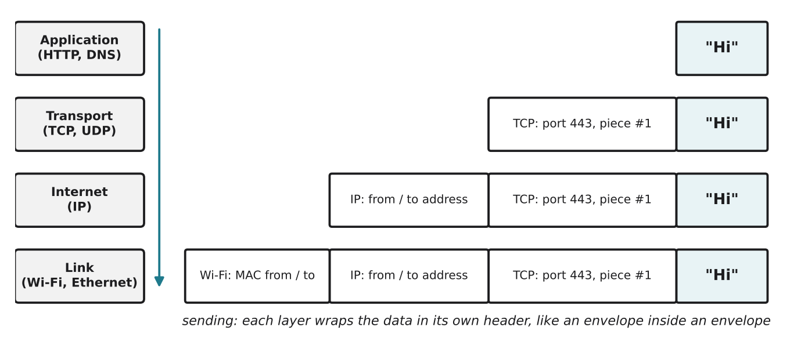

# 2.4 Protocols and layers

Author: Karbuzov Sanzhar 1820262137 | Reviewed by: Benslima Khalid 1820262152 | Status: checked

Read first: [2.2 Packets](2-2-packets.md) and [2.3 IP addresses](2-3-ip-addresses.md)

## After this section you can

- explain what a protocol is
- name the four layers of the TCP/IP model and the job of each
- describe how a message is wrapped in headers on the way down (encapsulation)
- decide which layer is responsible for a given problem

## Start with an example

When you send "Hi" in a chat app, at least four different things must happen:

- the app must know it is a chat message for your friend,
- the message must arrive complete and in order,
- it must find its way across many networks,
- it must physically travel over Wi-Fi, cables or radio.

Instead of one giant program doing everything, networks split these jobs into **layers**. Each layer does one job and trusts the layers below it to do theirs.

## Words you need

- **Protocol:** a set of agreed rules for communication: what to send, in what format, and how to answer. Like the rule "say hello, wait for a reply, then talk".
- **Layer:** a group of protocols that does one kind of job.
- **TCP/IP model:** the four-layer model the internet uses.
- **Encapsulation:** each layer wrapping the data from the layer above inside its own header, like putting a letter in an envelope, then that envelope in a bigger one.

## Explanation

### The four layers

| Layer | Job | Example protocols | Uses |
| --- | --- | --- | --- |
| 4. Application | what the data means for the app | HTTP, HTTPS, DNS | (2.6, 2.7) |
| 3. Transport | gets data to the right program, reliably if needed | TCP, UDP | ports (2.3), 2.5 |
| 2. Internet | gets packets across many networks | IP | IP addresses (2.3) |
| 1. Link | moves data across one local link | Wi-Fi, Ethernet | MAC addresses (2.3) |

### Encapsulation

*Figure 2.4.1: Sending "Hi". Going down the layers, each one adds a header in front. At the receiver the headers are removed in the opposite order, and the app gets "Hi" back.*

When the data arrives, the receiver goes **up** the layers: the link layer removes the Wi-Fi header, the internet layer checks the IP address and removes the IP header, the transport layer gives the data to the right program using the port, and the app shows "Hi".

### Why layers are useful

Each layer can change without the others noticing. When your phone switches from Wi-Fi to 4G, only the link layer changes; the chat app does not need a new version. This is like the post: you can write the same letter whether it goes by plane or by train.

### What about the OSI model?

You may see a seven-layer model called **OSI**. It splits the same jobs into more, smaller layers. It is useful for teaching and naming, but the internet itself is built on the four-layer TCP/IP model, which is what this module uses.

## Worked example: Dusty receives "PAUSE"

You tap "Pause" in the app. On Dusty's side, the data goes **up** the layers:

1. **Link:** the Wi-Fi chip receives radio signals and checks that the frame is for its MAC address. It removes the Wi-Fi header.
2. **Internet:** the IP header says the packet is for 192.168.1.37 (Dusty). The IP header is removed.
3. **Transport:** the TCP header carries the port number that belongs to Dusty's control program, and a sequence number. TCP checks that nothing is missing, and passes the data to the control program.
4. **Application:** the control program reads the command "PAUSE" and stops the wheels.

## Try it yourself

**Q1. Which layer?** a) choosing the route across several countries b) making sure lost data is sent again c) a web page request "GET /index.html" d) the radio signal between Dusty and the router

**Q2. Order.** When your phone *sends* a message, in which order are these headers added? IP header, Wi-Fi header, TCP header.

**Q3. Predict.** Your laptop changes from a Wi-Fi network to a cable (Ethernet). Which layer's protocol changes? Does your browser need to change? Explain.

**Q4. Find the error.** "The IP protocol makes sure that all packets arrive and are in the right order." Correct this sentence.

**Q5. Explain.** Use the envelope comparison to explain why a router in the middle of the internet does not need to read the chat message "Hi" itself.

## Answers

**Q1.** a) Internet layer (IP) b) Transport layer (TCP) c) Application layer (HTTP) d) Link layer (Wi-Fi)

**Q2.** From the top down: **TCP header first**, then the IP header, then the Wi-Fi header (Wi-Fi is outermost, as in Figure 2.4.1).

**Q3.** Only the **link layer** changes (from Wi-Fi to Ethernet). The internet, transport and application layers stay the same, so the browser does not change. This independence is the main reason we use layers.

**Q4.** IP only tries to deliver each packet to the right address; it does **not** guarantee delivery or order. **TCP** (transport layer) checks for missing packets, asks for them again and puts them in order (2.5).

**Q5.** A router only needs the address on the IP "envelope" to decide where to send the packet next. The chat message is inside, in the innermost envelope, and only the receiving app opens it. (With HTTPS or other encryption the inner content is even locked, see 2.7.)

## Common mistakes

- **Thinking a protocol is a program.** A protocol is a set of rules; programs follow them.
- **Mixing up IP and TCP.** IP = addresses and routes. TCP = reliability and order.
- **Thinking the OSI model is "the internet".** The internet uses the TCP/IP model; OSI is a teaching and reference model.

## Sources

1. Kurose, J. F., & Ross, K. W. (2021). *Computer Networking: A Top-Down Approach* (8th ed.). Pearson. Section 1.5, "Protocol Layers and Their Service Models".
2. Wikipedia. "Internet protocol suite." https://en.wikipedia.org/wiki/Internet_protocol_suite (accessed 5 Nov 2026)

Next: [2.5 TCP and UDP](2-5-tcp-and-udp.md)
