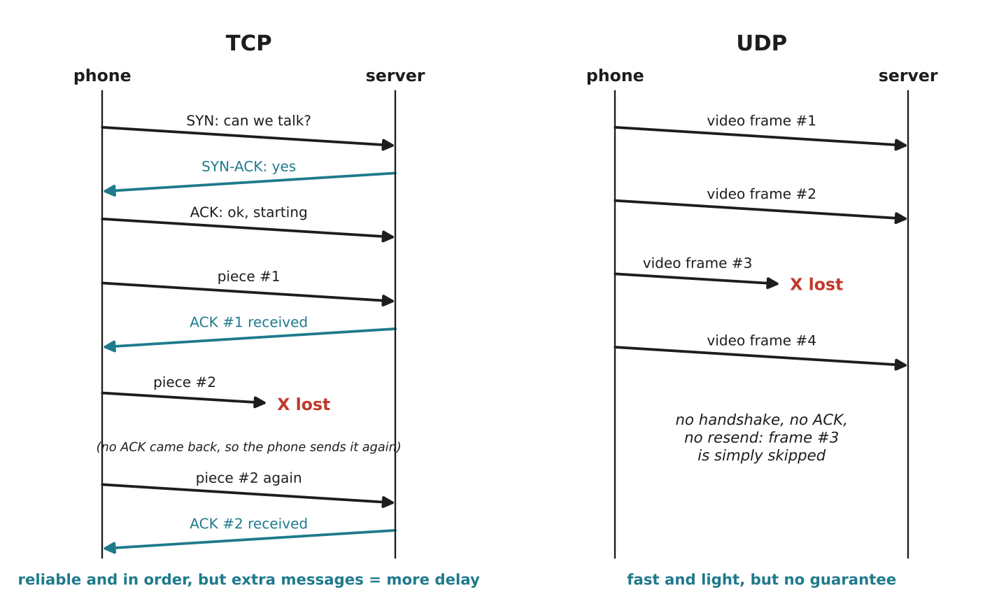

# 2.5 TCP and UDP

Author: Ali Ahmed 1820262072 | Reviewed by: Karbuzov Sanzhar 1820262137 | Status: checked

Read first: [2.2 Packets](2-2-packets.md) and [2.4 Protocols and layers](2-4-protocols-and-layers.md)

## After this section you can

- explain how TCP makes delivery reliable (handshake, acknowledgements, resending)
- explain why UDP is faster but gives no guarantees
- choose TCP or UDP for an application and justify the choice
- predict what each protocol does when a packet is lost

## Start with an example

Think about two ways of sending things to a friend:

- **Registered mail:** you call first to check they are home, every parcel is numbered, your friend signs for each one, and if one gets lost you send it again. Safe, but slow.
- **Shouting across the street:** you just shout. Fast, but if a bus drives by and your friend misses a word, it is gone.

The internet's transport layer (2.4) offers both: **TCP** is the registered mail, **UDP** is the shouting.

## Words you need

- **TCP (Transmission Control Protocol):** a transport protocol that delivers all data, in order, without errors, or reports that it could not.
- **UDP (User Datagram Protocol):** a transport protocol that just sends packets, with no checking, no ordering and no resending.
- **Connection:** an agreement between two devices to exchange data, set up before sending.
- **Handshake:** the messages that set up a TCP connection: SYN, SYN-ACK, ACK.
- **Acknowledgement (ACK):** a short reply meaning "I received this".
- **Timeout:** the time a sender waits for an ACK before it decides the packet was lost and sends it again.
- **Latency (delay):** the time data needs to travel from sender to receiver.

## Explanation

*Figure 2.5.1: Left: TCP sets up a connection, gets an ACK for each piece, and resends piece #2 when no ACK arrives. Right: UDP just sends; lost frame #3 is skipped.*

### How TCP makes delivery reliable

1. **Handshake.** Before sending data: SYN ("can we talk?"), SYN-ACK ("yes"), ACK ("OK, starting").
2. **Numbering.** Every piece of data has a sequence number (as in 2.2).
3. **Acknowledgements.** The receiver sends ACKs for what it received.
4. **Resending.** If no ACK arrives before the timeout, the sender sends the data again.
5. **Ordering.** The receiver puts pieces in order before giving them to the app.

The price: extra messages and waiting, so more delay.

### Why anyone uses UDP

For some apps, **late data is useless**. In a video call, a frame that arrives half a second late is worse than a frame that never arrives: the picture would freeze while TCP waits for the resend. With UDP the app simply skips the lost frame and keeps going; you might see a tiny glitch.

| | TCP | UDP |
| --- | --- | --- |
| Connection first? | yes (handshake) | no |
| Lost data resent? | yes | no |
| Arrives in order? | yes | not guaranteed |
| Speed / delay | slower, more delay | faster, less delay |
| Good for | web pages, email, files, app commands, updates | video calls, online games, live streams |

## Worked example: Dusty's firmware update

Dusty downloads a new version of its software (a firmware update, 5 MB) and you are watching a live video from Dusty's camera at the same time.

- **Firmware update → TCP.** If even one byte is missing or wrong, the new software could crash and Dusty might stop working. Every byte must arrive, so the update uses TCP; a few seconds of extra delay do not matter.
- **Live video → UDP.** You want to see what is happening *now*. If one frame is lost, the next frame shows the current picture anyway. Waiting for an old frame would only make the video lag.

## Try it yourself

**Q1. Choose and justify.** TCP or UDP? Give a reason for each. a) sending an email b) a multiplayer shooting game sending player positions c) downloading a PDF from Lexue d) a live football stream e) the command "STOP" sent to Dusty

**Q2. Trace.** A TCP sender sends pieces #1, #2, #3. The receiver gets #1 and #3, but #2 is lost. Describe what happens next, step by step.

**Q3. Predict.** A video call uses UDP and 1 frame in 50 is lost. What does the user see? Then imagine the call used TCP on the same bad network. What would the user see instead?

**Q4. Find the error.** "UDP is bad and old; every modern app should use TCP." Explain why this is wrong.

**Q5. Count.** Before TCP sends the first byte of data, how many handshake messages travel between the two devices? Why does this matter for a very short request?

## Answers

**Q1.**
a) **TCP**: the email must arrive complete.
b) **UDP**: an old position is useless; the next update replaces it.
c) **TCP**: a PDF with missing bytes would be broken.
d) **UDP** (typical for live streaming): low delay matters more than every frame. (Recorded videos, like a lesson you watch later, often use TCP because a short wait for buffering is acceptable.)
e) **TCP**: a command must arrive exactly and must not get lost.

**Q2.** The receiver sends ACKs for what it got, which shows that #2 is missing. The sender gets no ACK for #2 before the timeout (or notices the gap from the ACKs), so it **sends #2 again**. The receiver keeps #3 waiting, and when #2 arrives it puts #1, #2, #3 in order and gives them to the app.

**Q3.** With UDP: a tiny jump or blur about once every 2 seconds (at 25 frames per second), but the call stays live. With TCP: the picture would **freeze** each time a frame is lost, until the resend arrives, and the delay would grow; the conversation would feel laggy.

**Q4.** Neither is "better"; they make different trade-offs. UDP is the right choice when low delay matters more than completeness (calls, games, live video). Some modern protocols are even built on top of UDP, adding their own reliability in a faster way (for example QUIC, used by HTTP/3).

**Q5.** **Three** messages (SYN, SYN-ACK, ACK). For a very short request, the handshake can take as long as the request itself, which is why short lookups such as DNS (2.6) usually use UDP.

## Common mistakes

- **Thinking UDP data always gets lost.** Most UDP packets arrive fine; UDP just does not check or resend.
- **Thinking TCP is "faster because it is reliable".** Reliability costs time.
- **Thinking video always uses UDP.** Live calls usually do; recorded videos often use TCP with buffering.

## Sources

1. Kurose, J. F., & Ross, K. W. (2021). *Computer Networking: A Top-Down Approach* (8th ed.). Pearson. Chapter 3, "Transport Layer".
2. Cloudflare Learning Center. "What is the User Datagram Protocol (UDP)?" https://www.cloudflare.com/learning/ddos/glossary/user-datagram-protocol-udp/ (accessed 5 Nov 2026)

Next: [2.6 DNS and opening a website](2-6-dns-and-opening-a-website.md)
