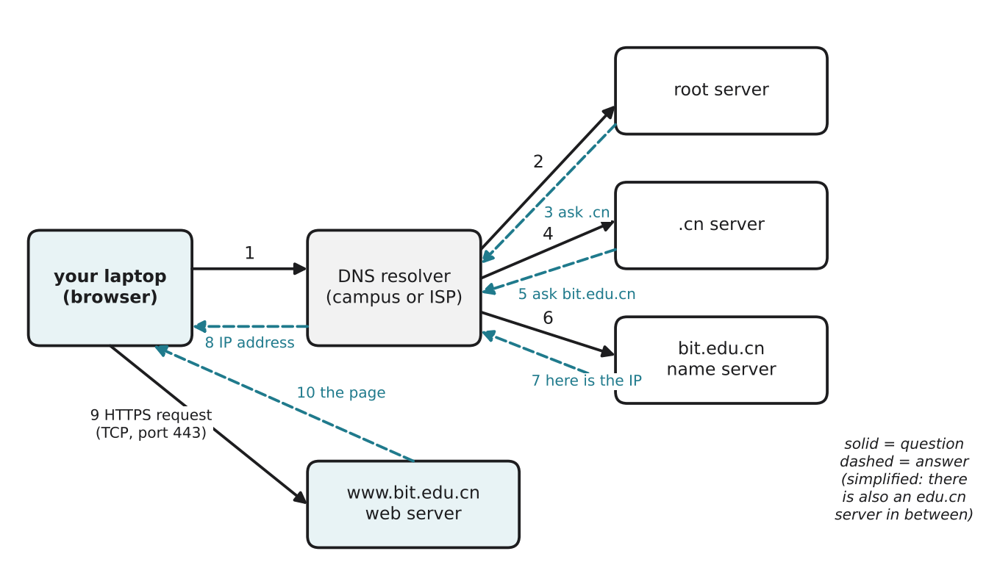

# 2.6 DNS and opening a website

Author: Ali Ahmed 1820262072 | Reviewed by: Karbuzov Sanzhar 1820262137 | Status: checked

Read first: [2.3 IP addresses](2-3-ip-addresses.md) and [2.5 TCP and UDP](2-5-tcp-and-udp.md)

## After this section you can

- explain why we need DNS
- describe the steps of a DNS lookup
- list, in order, what happens between typing a web address and seeing the page
- use nslookup, ping and traceroute to observe these steps yourself

## Start with an example

You type **www.bit.edu.cn** and press Enter. The page appears in about a second. But from 2.3 you know that packets need **IP addresses**, not names. Where did your computer get the IP address of the BIT website?

From a system that works like the internet's phone book: **DNS**.

## Words you need

- **Domain name:** a human-friendly name for a computer on the internet, such as www.bit.edu.cn.
- **DNS (Domain Name System):** the system that translates domain names into IP addresses.
- **DNS resolver:** the server (usually run by your campus or ISP) that does the lookup work for you.
- **Root server, TLD server, name server:** DNS servers at different levels. The **root** knows where the servers for top-level domains like .cn and .com are; the **TLD** (top-level domain) server for .cn knows the servers for domains under .cn; the domain's own **name server** knows its exact IP addresses.
- **Cache:** a stored copy of a recent answer, so the lookup does not have to be repeated (the same idea as cache in 1.5).
- **HTTP request / response:** the browser asks for a page; the server answers with it (more in 2.7).

## Explanation

### The DNS lookup



*Figure 2.6.1: Steps 1 to 8: finding the IP address. Steps 9 and 10: getting the page. Solid arrows are questions, dashed arrows are answers. (Simplified: in reality there is also a server for edu.cn between .cn and bit.edu.cn.)*

1. Your laptop asks the **resolver**: "What is the IP of www.bit.edu.cn?"
2-3. The resolver asks a **root server**, which answers: "I don't know, but ask the .cn server."
4-5. The resolver asks the **.cn server**, which points to the name server responsible for bit.edu.cn.
6-7. The resolver asks **that name server**, which gives the IP address.
8. The resolver sends the IP address to your laptop.

The resolver and your laptop keep the answer in **cache** for a while. The next time, steps 2 to 7 are skipped and the answer comes almost instantly. DNS questions are short, so they usually use **UDP** (2.5).

### From IP address to page

9. The browser opens a **TCP** connection to the IP address, on port 443 for HTTPS (with an extra step that sets up encryption, see 2.7), and sends an **HTTP request**: "GET the main page".
10. The server sends an **HTTP response** with the page (HTML). The browser then requests the other files the page needs (pictures, styles), and finally draws the page on the screen.

## Worked example: watch it happen

Open a terminal (macOS: Terminal; Windows: Command Prompt) and type these three commands. Your numbers will be different from anyone else's, and that is normal.

**1. nslookup: do steps 1 to 8 by hand.**

```
nslookup www.bit.edu.cn
```

Look for the lines `Server:` (that is your resolver) and `Address:` under "Name:" (that is the IP address of the website). You have just done a DNS lookup.

**2. ping: is it reachable, and how long does it take?**

```
ping www.bit.edu.cn
```

Each line shows a reply and a `time=` value in milliseconds: how long a small packet took to go there and come back. Press Ctrl+C to stop on macOS (Windows stops after 4 tries). Some servers are set not to answer ping; then you only see "Request timeout", even though the website works.

**3. traceroute: which routers are on the way?**

```
traceroute www.bit.edu.cn        (macOS)
tracert www.bit.edu.cn           (Windows)
```

Each numbered line is one router (one "hop") between you and the server, with its delay. Lines with `* * *` are routers that did not answer; this is common and not an error.

What to notice: the first hop is usually your own router (an address like 192.168.x.x or 10.x.x.x, see 2.3); the delay grows as the packets go further.

## Try it yourself

**Q1. Order the steps.** Put these in the correct order:
A) the browser draws the page  B) the resolver asks the root server  C) the browser sends an HTTP request  D) you type the address  E) the laptop receives the IP address  F) a TCP connection is opened

**Q2. Predict.** The DNS resolver on campus breaks, but the internet connection works. What happens when you type www.bit.edu.cn? What happens if you type the website's IP address directly instead?

**Q3. Explain cache.** You open the same website twice within one minute. Why is the second DNS lookup much faster?

**Q4. Try and record.** Run `nslookup` for two websites you use. Write down the IP addresses you get. Then run `ping` for one of them and write the average time. Is the website closer or further than you expected? (There is no single correct answer; the aim is to read the outputs.)

**Q5. Find the error.** "DNS sends you the web page." Correct this sentence.

**Q6. Dusty.** Dusty's app shows "Cannot reach server", but your phone can open other websites. Give two possible reasons, using this lesson.

## Answers

**Q1.** D, B, E, F, C, A.

**Q2.** With the name, the page does **not** open: the laptop cannot find the IP address (unless the answer is still in cache). With the IP address typed directly, the connection can still work, because DNS is only needed to translate the name. (Some websites refuse requests by IP address only, but the network path itself works.)

**Q3.** The answer from the first lookup was saved in **cache** (on your laptop and the resolver), so the laptop does not need to ask the root, .cn and bit.edu.cn servers again.

**Q4.** Answers will differ. A good answer names the resolver from the `Server:` line, gives the IP addresses from the `Address:` lines, and reads the `time=` values from ping (for example "about 30 ms on average").

**Q5.** DNS only gives the **IP address** of the server. The page itself comes from the **web server**, through an HTTP request and response over TCP.

**Q6.** Possible reasons: the DNS lookup for the robot company's server name fails; the company's server is down; Dusty itself is offline (for example the home router or Wi-Fi is off), so the server cannot reach it. (The phone's own internet works, because other websites open.)

## Common mistakes

- **Thinking DNS delivers the website.** DNS only gives the address; the web server delivers the page.
- **Thinking every lookup goes to the root server.** Thanks to caching, most lookups are answered quickly from cache.
- **Thinking `* * *` in traceroute means the internet is broken.** Many routers simply do not answer traceroute.

## Sources

1. Kurose, J. F., & Ross, K. W. (2021). *Computer Networking: A Top-Down Approach* (8th ed.). Pearson. Section 2.4, "DNS: The Internet's Directory Service".
2. Cloudflare Learning Center. "What is DNS?" https://www.cloudflare.com/learning/dns/what-is-dns/ (accessed 5 Nov 2026)

Next: [2.7 The web, HTTP and HTTPS](2-7-web-http-https.md)
