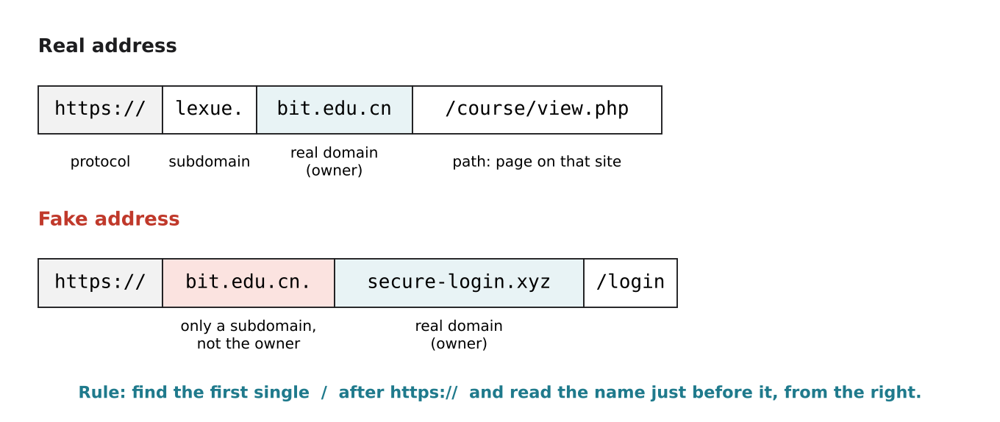

# 2.7 The web, HTTP and HTTPS

Author: Ali Ahmed 1820262072 | Reviewed by: Benslima Khalid 1820262152 | Status: checked

Read first: [2.6 DNS and opening a website](2-6-dns-and-opening-a-website.md)

## After this section you can

- explain the difference between the internet and the web
- describe an HTTP request and response, and read common status codes
- explain what HTTPS protects, and what it does not
- spot a fake website address

## Start with an example

You get a message: "Your Lexue account will be closed. Log in here: **https://bit.edu.cn.secure-login.xyz/login**". The link has a padlock and contains "bit.edu.cn". Is it safe?

No. By the end of this lesson you will be able to explain exactly why.

## Words you need

- **Internet:** the worldwide network of networks (Part 2 so far): the "roads".
- **Web (World Wide Web):** pages and links that we open in a browser, sent using HTTP: one kind of "traffic" on those roads.
- **HTTP (HyperText Transfer Protocol):** the application-layer protocol (2.4) for requesting and sending web pages.
- **Status code:** a three-digit number in an HTTP response that says how the request went.
- **HTTPS:** HTTP with encryption (using a protocol called TLS), so nobody in between can read or change the data.
- **Encryption:** scrambling data so only the intended receiver can read it.
- **Phishing:** tricking people into giving passwords or money, usually with a fake website or message.
- **URL:** a full web address, such as https://lexue.bit.edu.cn/course/view.php.

## Explanation

### Internet vs web

The internet carries many kinds of traffic: web pages, but also email, video calls, online games, and the messages between Dusty and its app. The web is only one of them. In 1989 Tim Berners-Lee invented the web at CERN, about 20 years after the first internet-style networks began.

### HTTP: request and response

A browser sends a short text request, for example:

```
GET /course/view.php HTTP/1.1
Host: lexue.bit.edu.cn
```

The server answers with a status code and the content. Common status codes:

| Code | Meaning |
| --- | --- |
| 200 OK | everything worked, here is the page |
| 301 Moved Permanently | the page has moved to a new address |
| 404 Not Found | there is no page at this address |
| 500 Internal Server Error | something broke on the server |

### HTTPS: what the padlock means

With plain HTTP, every router on the way (2.6, traceroute) could read your password. With **HTTPS**, the data is encrypted between your browser and the server.

The padlock means: **"the connection to this domain is encrypted"**. It does **not** mean "this website is honest". A criminal can easily get a padlock for their own fake domain. So the padlock protects you from people reading your data on the way, but it cannot tell you whether you are talking to the right website.

### Reading the real domain



*Figure 2.7.1: The real owner of a website is the domain just before the first single "/". In the fake address, "bit.edu.cn." is only a subdomain of secure-login.xyz.*

Rule: after `https://`, find the first single `/`. Read the name just before it **from the right**. The last two or three parts (such as bit.edu.cn or secure-login.xyz) show who really owns the site. Everything to the left is a subdomain chosen by that owner, so a criminal can put any text there, including "bit.edu.cn".

## Worked example: the phishing link

URL: `https://bit.edu.cn.secure-login.xyz/login`

1. Remove `https://`: `bit.edu.cn.secure-login.xyz/login`
2. Cut at the first `/`: `bit.edu.cn.secure-login.xyz`
3. Read from the right: the domain ends in `.xyz`, and the owner is **secure-login.xyz**.
4. `bit.edu.cn.` on the left is just a subdomain that the owner of secure-login.xyz chose. **Fake.**

The padlock only means the connection to secure-login.xyz is encrypted; it gives no reason to trust that site.

## Try it yourself

**Q1. Real or fake?** For each URL, name the real domain and decide whether it belongs to BIT (bit.edu.cn).
a) https://lexue.bit.edu.cn/my/
b) https://www.blt.edu.cn/login
c) http://bit.edu.cn-pay.com/fees
d) https://mail.bit.edu.cn/
e) https://bit.edu.cn.secure-login.xyz/login

**Q2. Status codes.** What status code do you expect when: a) the page loads normally b) you mistype a page name on a working website c) the server's program crashes?

**Q3. Explain.** A friend says: "The site has a padlock, so it's safe to type my password." Write two or three sentences explaining what the padlock does and does not prove.

**Q4. Internet or web?** Which of these use the web? a) reading Wikipedia in Chrome b) a WeChat voice call c) Dusty's app sending "START" to the company's server d) online banking in a browser

**Q5. Dusty.** Why should Dusty's app use HTTPS (or another encrypted connection) and not plain HTTP? Think about what the app sends (the map of your flat, your Wi-Fi name, your schedule).

## Answers

**Q1.**
a) Domain **bit.edu.cn**: real (lexue is a subdomain).
b) Domain **blt.edu.cn**: fake ("l" instead of "i").
c) Domain **cn-pay.com**: fake (`bit.edu` is only a subdomain; also it uses http, not https).
d) Domain **bit.edu.cn**: real.
e) Domain **secure-login.xyz**: fake.

**Q2.** a) 200 OK b) 404 Not Found c) 500 Internal Server Error

**Q3.** The padlock only shows that the connection between your browser and *that* domain is encrypted, so nobody in between can read the password. It does not prove the domain belongs to who you think: a fake site can have a padlock too. Always check the real domain first.

**Q4.** a) and d) use the web (HTTP in a browser). b) is internet but not web (a call protocol). c) is internet traffic; many such apps also use HTTP(S) between the app and the server, but not a browser and web pages. Accept c) either way if the reasoning is explained.

**Q5.** With plain HTTP, anyone on the network path (a public Wi-Fi, a router on the way) could read the map of your home, when nobody is at home, and your Wi-Fi details, or even change commands. Encryption keeps this private and stops others from changing the messages.

## Common mistakes

- **Using "internet" and "web" as the same word.** The web is one service that runs on the internet.
- **Trusting the padlock.** It means "encrypted", not "honest".
- **Reading the domain from the left.** The owner is at the right end of the name, before the first "/".

## Sources

1. Kurose, J. F., & Ross, K. W. (2021). *Computer Networking: A Top-Down Approach* (8th ed.). Pearson. Section 2.2, "The Web and HTTP", and Chapter 8, "Security in Computer Networks".
2. MDN Web Docs. "HTTP." Mozilla. https://developer.mozilla.org/en-US/docs/Web/HTTP (accessed 5 Nov 2026)
3. Cloudflare Learning Center. "What is HTTPS?" https://www.cloudflare.com/learning/ssl/what-is-https/ (accessed 5 Nov 2026)

Next: Part 3 begins with [3.1 Three schools of AI](../3-BEHAVIOURIST_AI/3-1-three-schools-of-ai.md)
