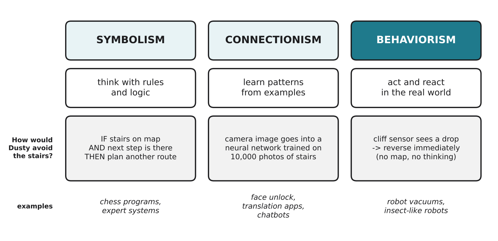

# 3.1 Three schools of AI

Author: Benslima Khalid 1820262152 | Reviewed by: Mussaldinov Rassul 1820262146 | Status: checked

Read first: Part 1 (hardware) is enough. Part 2 is not needed for this section.

## After this section you can

- name the three main schools of AI: symbolism, connectionism and behaviorism
- describe each one in one or two sentences, with an example
- sort real AI systems into the three schools
- compare how each school would solve the same problem

## Start with an example

Dusty must not fall down the stairs. Three engineers suggest three different solutions:

- **Engineer 1:** "Give Dusty a map of the flat with the stairs marked, and rules: never plan a route through a stairs square."
- **Engineer 2:** "Put a camera on Dusty and train a neural network on 10,000 photos of stairs, so it learns what stairs look like."
- **Engineer 3:** "Forget maps and photos. Put a sensor underneath. If there is no floor, reverse. Done."

All three are AI. They come from three different **schools** (ways of thinking) about what intelligence is.

## Words you need

- **Symbolism (symbolic AI):** intelligence as reasoning with symbols and rules: facts, IF-THEN rules, logic and search.
- **Connectionism:** intelligence as patterns learned from many examples by networks of simple connected units (neural networks).
- **Behaviorism (behaviorist AI, sometimes called actionism):** intelligence as acting well in the real world through a direct connection between sensing and acting, without needing a model of the world.
- **Neural network:** a program made of many simple connected units whose connection strengths are adjusted during training.
- **Expert system:** a symbolic AI program that uses rules written by human experts.

## Explanation

*Figure 3.1.1: The three schools, their main idea, how each would keep Dusty away from the stairs, and typical examples.*

### Symbolism: "think with rules"

Knowledge is written down as symbols (words, facts) and rules, and the computer reasons with them step by step. Classic examples are chess programs that search through possible moves, and expert systems such as MYCIN (1970s), which suggested treatments for infections using about 600 rules. Strength: the reasoning can be explained ("I chose this because rule 12 applied"). Weakness: someone must write all the rules, and the real world is messy.

### Connectionism: "learn from examples"

Instead of writing rules, we show a neural network many examples and it adjusts itself until its answers are good. Face unlock, translation apps and chatbots work this way. Strength: it can learn things that are hard to describe with rules (what a face looks like). Weakness: it needs a lot of data and computing power (the GPUs from 1.7), and it is hard to explain *why* it gave an answer.

### Behaviorism: "act and react"

Intelligence is seen in **behavior**: an insect has a tiny brain and no map of the world, but it walks, avoids danger and finds food. Behaviorist AI builds machines that sense and act directly, in a loop, and become more capable by adding simple behaviors. Its roots are in cybernetics (3.2), and its most famous form is Rodney Brooks's robots (3.4). Learning from rewards (3.5) is also closely connected to this school. Strength: fast, robust, cheap. Weakness: little planning or reasoning (3.6).

### Real systems often mix

Many modern systems combine schools. AlphaGo, which beat the world's top Go players, used neural networks (connectionism), searched through possible moves (symbolism), and improved by playing against itself and learning from wins and losses (learning from rewards). Modern robot vacuums mix a reactive safety layer (behaviorism) with a map and route planning (symbolism).

## Worked example: comparing the three solutions

| | Map and rules (symbolism) | Camera and neural network (connectionism) | Cliff sensor (behaviorism) |
| --- | --- | --- | --- |
| What it needs | an accurate map, rules | thousands of labeled photos, training | one cheap sensor, one rule |
| A new house | must draw a new map | probably works if photos were varied | works at once |
| Dark room | fine, if the map is right | may fail (camera sees little) | works (uses its own light) |
| Explains itself? | yes, by the rules | hard | yes, but there is little to explain |

For this one job, the behaviorist solution is the simplest and most reliable, which is why almost all robot vacuums have cliff sensors.

## Try it yourself

**Q1. Sort.** Which school does each system mainly belong to? a) a chess program that searches millions of moves b) face unlock on a phone c) a robot insect that walks over rocks by reacting with each leg d) a medical program with 600 IF-THEN rules from doctors e) a translation app trained on millions of sentence pairs f) a thermostat-like controller that keeps a drone level

**Q2. Compare.** Choose any two schools. In two or three sentences, explain one strength and one weakness of each.

**Q3. Design.** Dusty must learn to avoid socks on the floor. Describe how a symbolist, a connectionist and a behaviorist engineer might each solve this. Which would you choose, and why?

**Q4. Find the error.** "Behaviorist AI is called that because it studies human behavior on social media." What is wrong?

**Q5. Explain.** Why do many real systems combine schools? Use AlphaGo or a robot vacuum as your example.

## Answers

**Q1.** a) symbolism b) connectionism c) behaviorism d) symbolism (expert system) e) connectionism f) behaviorism (feedback control, see 3.2)

**Q2.** Example: Symbolism is easy to explain because you can point to the rule that was used, but it needs people to write every rule and fails when the world does not match the rules. Connectionism can learn hard patterns such as faces, but needs lots of data and computing power, and its decisions are hard to explain.

**Q3.** Symbolist: describe socks with rules (small, soft, certain shapes) and plan routes around them; hard, because socks look very different. Connectionist: a camera and a neural network trained on many photos of socks; likely works best, but needs data and a stronger chip. Behaviorist: a rule like "if the brush motor suddenly works much harder, stop and reverse" (a sock is being sucked in); cheap, but only reacts after touching the sock. Any choice is fine if it is justified; many real robots use the camera solution.

**Q4.** "Behaviorism" here means intelligence shown through **behavior in the environment** (sensing and acting), inspired by how animals behave. It has nothing to do with studying people on social media.

**Q5.** Each school is strong where others are weak. AlphaGo needed neural networks to judge positions, search to look ahead, and learning from rewards to improve. A robot vacuum needs fast reactions for safety (behaviorism) but also a map to clean a whole flat efficiently (symbolism).

## Common mistakes

- **Thinking AI means only chatbots.** Chatbots are one kind of connectionist AI. A cliff-sensing robot is AI too.
- **Thinking one school is "the right one".** Each fits different problems, and real systems often mix them.
- **Thinking behaviorist robots learn nothing.** Basic reactive robots do not learn, but learning from rewards (3.5) belongs to the same tradition.

## Sources

1. Russell, S., & Norvig, P. (2021). *Artificial Intelligence: A Modern Approach* (4th ed.). Pearson. Chapter 1, "Introduction" (history of AI).
2. Brooks, R. A. (1991). Intelligence without representation. *Artificial Intelligence, 47*(1-3), 139-159.
3. Silver, D., et al. (2016). Mastering the game of Go with deep neural networks and tree search. *Nature, 529*, 484-489.

Next: [3.2 Cybernetics and feedback](3-2-cybernetics-and-feedback.md)
