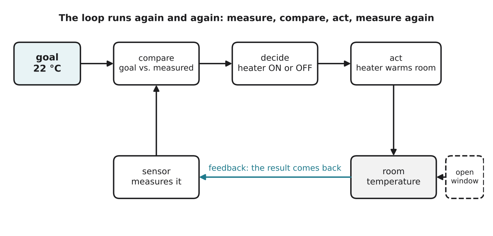

# 3.2 Cybernetics and feedback

Author: Benslima Khalid 1820262152 | Reviewed by: Mussaldinov Rassul 1820262146 | Status: checked

Read first: [3.1 Three schools of AI](3-1-three-schools-of-ai.md)

## After this section you can

- explain what a feedback loop is and name its parts
- trace a thermostat's decisions step by step
- tell negative feedback from positive feedback
- find feedback loops in everyday machines and in Dusty

## Start with an example

Your dorm room has a heater with a thermostat set to 22 °C. Nobody touches it, yet the room stays close to 22 °C all day, even when someone opens a window. The thermostat has no brain and no map. How does it "know" what to do?

It keeps doing one simple thing: **measure, compare with the goal, act, measure again**.

## Words you need

- **Cybernetics:** the study of control and communication in machines and living things. The name comes from a Greek word meaning "steersman"; Norbert Wiener made the field famous with his 1948 book *Cybernetics*.
- **Goal (set point):** the value the system tries to reach, such as 22 °C.
- **Feedback:** information about the result of an action that comes back and affects the next action.
- **Feedback loop:** the repeating cycle measure → compare → act → measure ...
- **Negative feedback:** feedback that *reduces* the difference from the goal and keeps things stable.
- **Positive feedback:** feedback that *increases* the difference, so things grow out of control.
- **Disturbance:** something from outside that pushes the system away from its goal (an open window).

## Explanation

*Figure 3.2.1: The thermostat loop. The sensor's measurement goes back to the comparison, so every action is based on the latest result. The open window is a disturbance.*

### The parts of a feedback loop

1. **Sensor:** measures what is happening (a thermometer).
2. **Compare:** checks the measurement against the goal (18 °C is below 22 °C).
3. **Decide and act:** chooses an action (heater ON) and does it.
4. **Feedback:** the action changes the world, the sensor measures the new value, and the loop starts again.

This is the root of behaviorist AI (3.1): sensible-looking behavior from a simple, fast loop between sensing and acting, with no plan and no model.

### A gap to avoid flickering

If the rule were simply "below 22 → ON, above 22 → OFF", the heater would switch on and off every few seconds around 22 °C. Real thermostats use a small gap:

- below **21 °C** → heater ON
- above **23 °C** → heater OFF
- between 21 and 23 → **keep** whatever it is doing now

### Negative and positive feedback

- **Negative feedback** (stabilizing): room too cold → heat → warmer → stop heating. Almost all control systems use it.
- **Positive feedback** (runaway): a microphone picks up sound from a speaker, the speaker plays it louder, the microphone picks it up again ... and you hear a loud squeal. Each round makes the difference bigger.

### Feedback everywhere

Feedback was used long before computers: in the 1780s, James Watt's steam engines used a spinning "governor" that closed the steam valve when the engine ran too fast. Today: cruise control in cars, a fridge, your body keeping its temperature near 37 °C, and Dusty following a wall at a fixed distance.

## Worked example: tracing the thermostat

Rules: below 21 → ON; above 23 → OFF; otherwise keep the current state. The heater starts OFF.

| Time | Measured temperature | Rule that applies | Heater |
| --- | --- | --- | --- |
| 08:00 | 19.0 °C | below 21 | ON |
| 08:10 | 20.5 °C | below 21 | ON |
| 08:20 | 22.0 °C | between 21 and 23: keep | ON |
| 08:30 | 23.5 °C | above 23 | OFF |
| 08:40 | 22.5 °C | between: keep | OFF |
| 08:50 | 21.5 °C | between: keep | OFF |
| 09:00 | 20.8 °C | below 21 | ON |

The temperature goes up and down around the goal, but stays close to it. Nobody told the heater a plan; the loop did the work.

## Try it yourself

**Q1. Trace.** Same rules, heater starts ON. Readings: 22.0, 23.2, 22.9, 21.4, 20.9, 21.8. Write the heater state after each reading.

**Q2. Name the parts.** Cruise control keeps a car at 100 km/h. Name the goal, the sensor, the action, and one disturbance.

**Q3. Negative or positive?** a) a fridge switching its cooler on when it gets warm b) a microphone squeal c) your body sweating when you are hot d) a snowball rolling downhill and getting bigger and faster

**Q4. Predict.** What would happen in the worked example if someone moved the thermometer next to the heater? Explain using the word feedback.

**Q5. Dusty.** Dusty follows a wall and should stay 2 cm away from it, using a side distance sensor. Write two simple rules (one for "too close", one for "too far") that create a feedback loop.

## Answers

**Q1.** 22.0 → keep: **ON**. 23.2 → above 23: **OFF**. 22.9 → keep: **OFF**. 21.4 → keep: **OFF**. 20.9 → below 21: **ON**. 21.8 → keep: **ON**.

**Q2.** Goal: 100 km/h. Sensor: the speed sensor on the wheels. Action: more or less engine power. Disturbance: a hill or a strong headwind.

**Q3.** a) negative b) positive c) negative d) positive

**Q4.** The sensor would measure the hot air near the heater, not the room. The feedback would tell the thermostat "it is already warm" too early, so it would switch off while the room is still cold. A feedback loop is only as good as its measurement.

**Q5.** IF distance < 2 cm (too close) THEN turn slightly away from the wall. IF distance > 2 cm (too far) THEN turn slightly towards the wall. (A small gap, for example 1.5 to 2.5 cm, avoids constant zig-zagging, just like the thermostat.) Each turn changes the distance, the sensor measures again, and the loop corrects the next move.

## Common mistakes

- **Thinking feedback means "a comment from someone".** In control systems it means the result of an action coming back as input.
- **Thinking negative feedback is bad.** Negative feedback is the useful, stabilizing kind.
- **Forgetting the loop repeats.** One measurement and one action is not feedback; the result must come back and affect the next action.

## Sources

1. Wiener, N. (1948). *Cybernetics: Or Control and Communication in the Animal and the Machine.* MIT Press.
2. Wikipedia. "Negative feedback." https://en.wikipedia.org/wiki/Negative_feedback (accessed 5 Nov 2026)
3. Wikipedia. "Centrifugal governor." https://en.wikipedia.org/wiki/Centrifugal_governor (accessed 5 Nov 2026)

Next: [3.3 Agents and environments](3-3-agents-and-environments.md)
