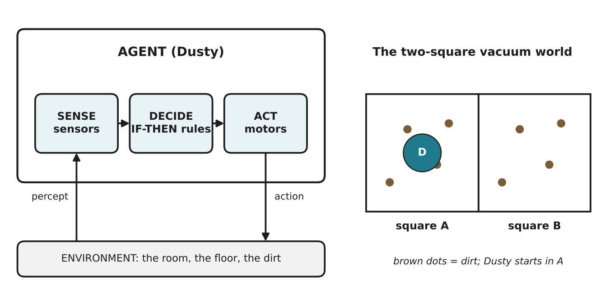

# 3.3 Agents and environments

Author: Benslima Khalid 1820262152 | Reviewed by: Mussaldinov Rassul 1820262146 | Status: checked

Read first: [3.2 Cybernetics and feedback](3-2-cybernetics-and-feedback.md)

## After this section you can

- explain what an agent, an environment, a percept and an action are
- describe the sense, decide, act loop
- write condition-action rules for a simple reactive agent
- trace a reactive agent and find where it behaves badly

## Start with an example

Put Dusty in a small room with dirt on the floor. Every fraction of a second Dusty does the same three things: it **senses** (bumper? cliff? dirt?), it **decides** (which rule fits?), and it **acts** (drive, turn, suck). Then again. And again.

In AI, anything that works like this is called an **agent**.

## Words you need

- **Agent:** anything that perceives its environment through sensors and acts on it through actuators.
- **Environment:** the part of the world the agent lives in and acts on.
- **Percept:** what the agent's sensors report at one moment.
- **Action:** what the agent does at one moment.
- **Sense, decide, act loop:** the repeating cycle of an agent; a feedback loop (3.2) with a decision in the middle.
- **Condition-action rule:** an IF-THEN rule that connects a percept to an action, for example "IF dirty THEN suck".
- **Reactive agent (simple reflex agent):** an agent that decides **only from the current percept**, using condition-action rules. It has no memory and no plan.

## Explanation

*Figure 3.3.1: Left: the agent senses the environment, decides with rules, and acts, changing the environment. Right: the classic "vacuum world" with two squares, A and B.*

### Why "reactive"?

A reactive agent does not remember where it has been and does not plan where to go. It looks at the present moment and reacts. That sounds stupid, but it is fast, cheap and surprisingly effective, as insects show. It is the basic building block of behaviorist AI.

### The vacuum world

AI textbooks use a tiny world: two squares, A and B. Each square is clean or dirty. The agent knows only **which square it is in** and **whether that square is dirty**. It can do three actions: Suck, Left, Right.

Rules for a reactive vacuum agent:

1. IF the current square is dirty THEN **Suck**
2. ELSE IF in square A THEN **Right**
3. ELSE IF in square B THEN **Left**

The rules are checked in order; the first one that matches wins.

## Worked example: tracing the vacuum world

Start: Dusty in A, both squares dirty.

| Step | Location | Percept | Rule used | Action | After the action |
| --- | --- | --- | --- | --- | --- |
| 1 | A | A dirty | 1 | Suck | A clean, B dirty |
| 2 | A | A clean | 2 | Right | Dusty in B |
| 3 | B | B dirty | 1 | Suck | A clean, B clean |
| 4 | B | B clean | 3 | Left | Dusty in A |
| 5 | A | A clean | 2 | Right | Dusty in B |
| 6 | B | B clean | 3 | Left | Dusty in A |

After step 3 the job is done, but Dusty keeps moving left and right forever, wasting battery. Why? It has **no memory**: in step 5 it cannot know that B was already cleaned. This is a limit of purely reactive agents (more in 3.6).

## Try it yourself

**Q1. Name the parts.** For a self-driving delivery robot on a campus, give two sensors, two actuators, one percept and one action.

**Q2. Trace.** Same rules as above. Start: Dusty in **B**, A dirty, B clean. Trace 5 steps in a table.

**Q3. Write rules.** Real Dusty has a bumper, a cliff sensor and a dirt sensor. Write at least three condition-action rules, in order of checking, so that it cleans dirt, never falls down stairs and gets away from obstacles. Explain why your order matters.

**Q4. Find the error.** A student's rules are:
1. IF in square A THEN Right
2. IF in square B THEN Left
3. IF dirty THEN Suck
What goes wrong when Dusty starts in a dirty square A? How do you fix it?

**Q5. Improve.** Add one small piece of memory to the vacuum-world agent so that it stops moving when both squares are clean. Describe the memory and the new rule. Is the agent still purely reactive?

## Answers

**Q1.** Example: sensors: camera, lidar (or bumper, GPS); actuators: wheel motors, a lock on the delivery box; percept: "a person is 1 m in front"; action: "stop".

**Q2.**

| Step | Location | Percept | Rule | Action | After |
| --- | --- | --- | --- | --- | --- |
| 1 | B | B clean | 3 | Left | in A |
| 2 | A | A dirty | 1 | Suck | A clean |
| 3 | A | A clean | 2 | Right | in B |
| 4 | B | B clean | 3 | Left | in A |
| 5 | A | A clean | 2 | Right | in B |

**Q3.** One good answer: 1) IF the cliff sensor sees no floor THEN reverse and turn. 2) IF the bumper is pressed THEN back up and turn. 3) IF the dirt sensor detects dirt THEN suck harder / stay. 4) ELSE drive forward. The cliff rule must come first: if Dusty is at the edge of the stairs and also sees dirt, safety must win. Lesson 3.4 turns this idea into a layered design.

**Q4.** Rule 1 always matches in square A, so Dusty moves Right before it ever checks for dirt; rule 3 is never reached. Dusty moves between A and B forever and never sucks. Fix: put the dirt rule **first**. The order of rules is part of the program.

**Q5.** Memory: two remembered facts, "A is clean" and "B is clean", updated after each Suck or visit. New rule (checked first): IF remembered A is clean AND remembered B is clean THEN **stop**. The agent is no longer purely reactive, because it now decides using memory, not only the current percept. (Textbooks call this a model-based agent.)

## Common mistakes

- **Thinking an agent must be a robot.** A software program that senses and acts (for example a spam filter) is also an agent.
- **Ignoring rule order.** With IF-THEN rules checked in order, the first match wins.
- **Thinking "reactive" means "random".** Reactive agents follow fixed rules; they just do not remember or plan.

## Sources

1. Russell, S., & Norvig, P. (2021). *Artificial Intelligence: A Modern Approach* (4th ed.). Pearson. Chapter 2, "Intelligent Agents" (the vacuum-cleaner world and simple reflex agents).
2. Brooks, R. A. (1991). Intelligence without representation. *Artificial Intelligence, 47*(1-3), 139-159.

Next: [3.4 Subsumption architecture](3-4-subsumption-architecture.md)
