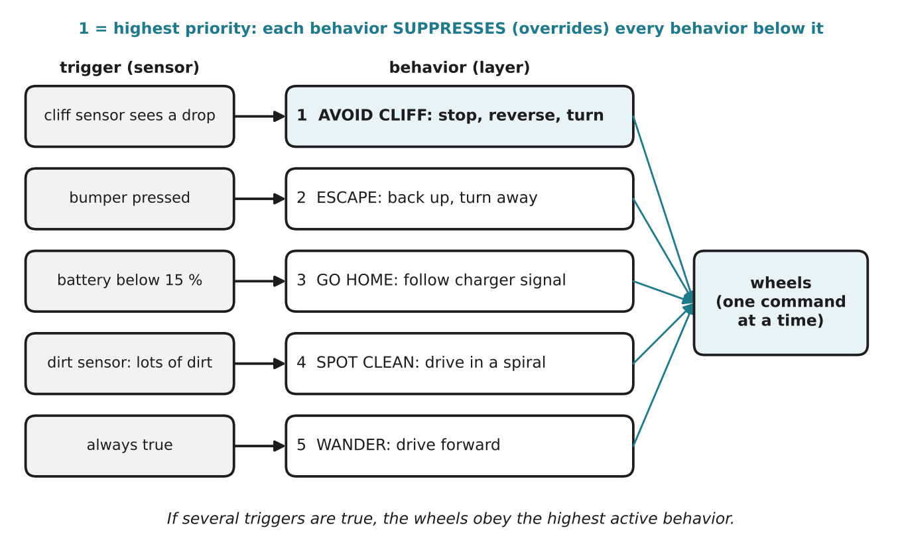

# 3.4 Subsumption architecture

Author: Mussaldinov Rassul 1820262146 | Reviewed by: Benslima Khalid 1820262152 | Status: checked

Read first: [3.3 Agents and environments](3-3-agents-and-environments.md)

## After this section you can

- explain Rodney Brooks's idea of building a robot from layers of simple behaviors
- explain what "intelligence without representation" means
- predict which behavior controls a robot when several are triggered at once
- add a new behavior to a layered design and decide where it belongs

## Start with an example

In 3.3 you wrote rules for Dusty: avoid cliffs, escape from obstacles, clean dirt, drive forward. But what happens when two rules want different things at the same moment? Dusty is at the edge of the stairs **and** its dirt sensor sees a big crumb. One rule says "stay and suck", the other says "reverse now".

In the 1980s, the roboticist **Rodney Brooks** at MIT proposed a clean answer: organize the behaviors in **layers**, and let the more urgent layers **override** the others.

## Words you need

- **Behavior:** a small, complete sense-act unit with one job, for example "escape from obstacles". Each behavior watches its own sensors and suggests its own action.
- **Layer:** one behavior (or a group) in the design. Brooks numbered them from layer 0, the most basic, upwards.
- **Subsumption architecture:** Brooks's design in which higher layers can **subsume** (take over) lower ones by suppressing their signals, while the lower layers keep running.
- **Suppress:** block another behavior's command and replace it with your own.
- **Arbitration:** deciding which behavior's command reaches the motors.
- **Representation:** an internal model of the world, such as a map.

## Explanation

### Brooks's idea: build up from simple behaviors

Traditional robots of the 1970s and 1980s worked like this: sense → build a detailed map of the world → plan → act. Building the map took so long that the robots were slow and fragile; when someone moved a chair, the plan broke.

Brooks turned this around:

1. Build the simplest useful behavior first (layer 0, for example "don't crash into things") and test it in the real world until it works.
2. Add a new layer on top (layer 1, "wander around") **without changing** layer 0.
3. Higher layers can suppress lower ones when they need to; when they are quiet, the lower layers simply keep working.

There is no central brain and no world map. Each behavior reacts directly to its sensors. Brooks summed this up as **"intelligence without representation"**: the world itself is the best model, so look at it instead of a stored copy. His robots, such as the six-legged walker Genghis (1989), walked over rough ground with only simple layered behaviors. The Roomba robot vacuum (2002) came from iRobot, a company Brooks co-founded.

### Dusty's behaviors

For Dusty we use a simplified, very common version of this idea: we list the behaviors by **priority**. When several behaviors want the wheels at the same moment, the one highest in the list wins.

*Figure 3.4.1: Dusty's five behaviors. Each has its own trigger. A more urgent behavior suppresses every behavior below it, so the wheels get only one command at a time.*

Note: Brooks numbered layers from the bottom, and in his robots higher layers suppress lower ones through special connections between modules. Our priority list is a simpler way to show the same key idea: separate simple behaviors, combined so that the right one takes over at the right moment.

## Worked example: who controls the wheels?

Each moment, look at which triggers are true, then take the **highest** active behavior.

| Moment | Triggers that are true | Active behaviors | Winner | Dusty does |
| --- | --- | --- | --- | --- |
| 1 | (none except "always") | 5 | 5 WANDER | drives forward |
| 2 | dirt sensor | 4, 5 | 4 SPOT CLEAN | drives in a spiral |
| 3 | bumper, dirt sensor | 2, 4, 5 | 2 ESCAPE | backs up and turns |
| 4 | battery below 15 % | 3, 5 | 3 GO HOME | follows charger signal |
| 5 | battery below 15 %, cliff | 1, 3, 5 | 1 AVOID CLIFF | stops, reverses, turns |
| 6 | battery below 15 % | 3, 5 | 3 GO HOME | continues home |

Look at moment 5: going home is important, but not falling down the stairs is more important. Once the cliff is behind it, GO HOME takes over again by itself (moment 6). Nobody wrote a plan for "cliff on the way home"; the layers handled it.

## Try it yourself

**Q1. Predict.** Which behavior wins, and what does Dusty do? a) bumper pressed and dirt detected b) battery 10 % and nothing else c) cliff detected and bumper pressed d) only "always true"

**Q2. Find the error.** A student orders the list: 1 WANDER, 2 SPOT CLEAN, 3 ESCAPE, 4 GO HOME, 5 AVOID CLIFF. Explain what will go wrong near the stairs.

**Q3. Add a behavior.** You add **CARPET BOOST**: "IF the carpet sensor says carpet THEN set the suction fan to maximum." Where in the list does it belong? Does it need to compete with the other behaviors at all? (Hint: which actuator does it use?)

**Q4. Add another.** You add **SCHEDULE**: "IF it is 14:00 AND Dusty is on the charger THEN leave the charger and start cleaning." Where would you put it, and why?

**Q5. Explain.** In your own words, what does "intelligence without representation" mean? Give one advantage and one risk of not having a map.

**Q6. Mini lecture link.** A person plays "robot" with three rule cards: (1) walk forward, (2) if you touch an obstacle, turn right, (3) if someone shows the "battery" card, walk to the charger. Which rule should win if two are true at once? Why does the person's path look "planned" to the audience, even though nobody planned it?

## Answers

**Q1.** a) ESCAPE (2): backs up and turns. b) GO HOME (3): follows the charger signal (WANDER is suppressed). c) AVOID CLIFF (1): stops, reverses, turns. d) WANDER (5): drives forward.

**Q2.** WANDER is now on top and its trigger is always true, so it **always wins**: Dusty drives forward no matter what. It ignores obstacles, dirt, a low battery and the cliff, and will drive down the stairs. Safety behaviors must have the highest priority.

**Q3.** It uses the **fan**, not the wheels, so it does not compete with the wheel behaviors at all: it can run in parallel with whatever behavior controls the wheels. In Brooks's style you simply add it as a new module without changing the others. If you must put it in the list, anywhere is fine, because no other behavior uses the fan.

**Q4.** Just above WANDER (or just below GO HOME): it should start the cleaning trip, but it must never override cliff, escape or going home with a low battery. Putting it above GO HOME would be dangerous: at 14:00 with a 5 % battery Dusty would leave the charger.

**Q5.** The robot does not build or store a model of the world; it reacts to what its sensors show right now. Advantage: fast and robust, because nothing breaks when furniture moves. Risk: it cannot plan (for example "clean the kitchen, then the bedroom") and can repeat the same mistake again and again (see 3.6).

**Q6.** As in Brooks's numbering, the higher card wins: (3) over (2) over (1). So the "battery" card makes the person head for the charger, and while no special card is active they walk forward and turn at obstacles. (A careful design keeps "turn at an obstacle" working on the way to the charger, which is why Dusty's list puts ESCAPE above GO HOME.) The path looks planned because the simple rules interact with the obstacles in the room: the environment shapes the behavior. This is the main idea of behaviorist AI.

## Common mistakes

- **Thinking higher layers switch the lower ones off forever.** They only override while their trigger is true; then the lower layers continue.
- **Putting the "always true" behavior at the top.** It would suppress everything below it.
- **Thinking behaviors must all compete.** Only behaviors that use the same actuator need arbitration.

## Sources

1. Brooks, R. A. (1986). A robust layered control system for a mobile robot. *IEEE Journal on Robotics and Automation, 2*(1), 14-23.
2. Brooks, R. A. (1991). Intelligence without representation. *Artificial Intelligence, 47*(1-3), 139-159.
3. Wikipedia. "Subsumption architecture." https://en.wikipedia.org/wiki/Subsumption_architecture (accessed 5 Nov 2026)

Next: [3.5 Learning from rewards](3-5-learning-from-rewards.md)
