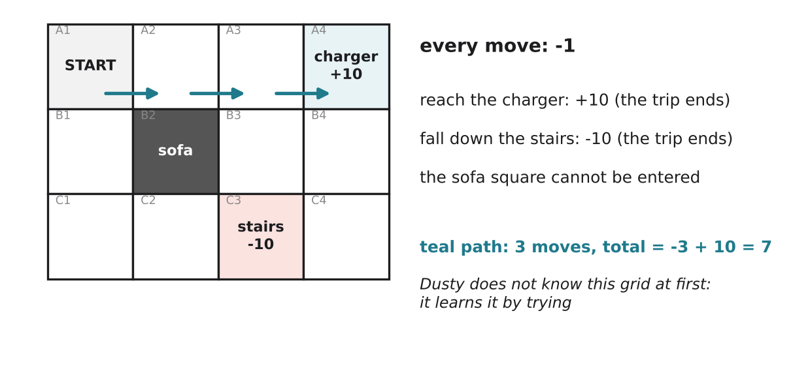

# 3.5 Learning from rewards

Author: Mussaldinov Rassul 1820262146 | Reviewed by: Benslima Khalid 1820262152 | Status: checked

Read first: [3.3 Agents and environments](3-3-agents-and-environments.md) and [3.4 Subsumption architecture](3-4-subsumption-architecture.md)

Level: idea only, no formulas (as agreed in our scope).

## After this section you can

- explain the basic idea of reinforcement learning using the words state, action, reward and policy
- calculate the total reward of a path
- predict which behavior a reward will encourage, including behavior nobody wanted
- explain the link between learning from rewards and behaviorism

## Start with an example

How do you teach a dog to sit? You do not explain the rule "sit = bend back legs". You wait until it sits, then give a treat. After many tries, the dog sits more and more often, because sitting led to something good.

Psychologists who studied learning like this (such as Edward Thorndike and B. F. Skinner) were called **behaviorists**. AI took the same idea: let the agent try, give it a **reward** or a **penalty**, and let it learn which actions work. This is called **reinforcement learning (RL)**.

## Words you need

- **State:** the situation the agent is in (for Dusty: which square of the room it is on).
- **Action:** what the agent can do in a state (move up, down, left, right).
- **Reward:** a number the agent receives after an action: positive = good, negative = bad (a penalty).
- **Total reward (return):** all the rewards from the start to the end of one trip added together.
- **Policy:** the agent's strategy: which action it chooses in each state.
- **Episode:** one complete try, from start to end.
- **Trial and error:** learning by trying actions and seeing what happens.

## Explanation

### How learning from rewards differs from 3.4

In 3.4, a human **wrote** Dusty's rules. In RL, nobody writes the best actions. The agent starts knowing nothing, tries actions, receives rewards, and slowly **builds its own policy**, keeping the actions that led to a high total reward.

### Rewards decide what is learned

The agent learns whatever gets rewarded, not what we *meant*. Choosing rewards is the most important design decision in RL, and mistakes can create strange behavior (see Q4).

### Exploration vs exploitation

An agent must balance two things: **exploit** (use the best action it knows so far) and **explore** (try something new that might be even better). A robot that only exploits may never discover a shorter path; one that only explores never uses what it learned.

## Worked example: Dusty finds the charger

*Figure 3.5.1: A 3 × 4 room. Dusty starts in A1. Each move costs -1. Reaching the charger (A4) gives +10, falling down the stairs (C3) gives -10, and both end the trip. The sofa (B2) cannot be entered.*

**Calculating total rewards for three paths:**

**Path 1** (the teal arrows): A1 → A2 → A3 → A4.

3 moves × (-1) = -3

-3 + 10 = **+7**

**Path 2:** A1 → A2 → A3 → B3 → B4 → A4.

5 moves × (-1) = -5

-5 + 10 = **+5**

**Path 3:** A1 → B1 → C1 → C2 → C3 (stairs!).

4 moves × (-1) = -4

-4 + (-10) = **-14**

**How Dusty learns.** At first Dusty does not know the grid. It tries random paths (exploration). After each episode it notes, for each square, which direction led to a good total reward. Over many episodes, "move right" in A1, A2 and A3 gets a better and better score, while moves towards C3 get worse ones. In the end its policy is Path 1: the shortest safe route. Because every move costs -1, shorter paths are better; because the stairs cost -10, the stairs are avoided.

## Try it yourself

**Q1. Calculate.** Find the total reward of the path A1 → B1 → C1 → C2 → B3 (careful: is every move legal?) Then calculate A1 → A2 → A3 → B3 → C3. Explain each result.

**Q2. Predict.** The designer changes the step cost from -1 to **0**. The charger is still +10 and the stairs still -10. Does Dusty still prefer Path 1 over Path 2? What changes?

**Q3. Design.** You want Dusty to learn to clean a dirty square (B4) on its way to the charger. Suggest a reward for reaching B4 and explain what Dusty would then learn. Which path would it choose?

**Q4. Find the problem.** A designer gives Dusty **+1 every time the dirt sensor detects dirt**. After learning, Dusty has found a trick that earns a lot of reward without cleaning the room well. Describe a possible trick and suggest a better reward.

**Q5. Compare.** In two or three sentences: how is a robot that learns from rewards different from Dusty's layered behaviors in 3.4? Give one advantage of each.

## Answers

**Q1.** C2 → B3 is a diagonal move, which is not allowed (only up, down, left, right), so the first path is illegal. Second path: 4 moves × (-1) = -4, then the stairs give -10, total **-14**. It reaches the stairs instead of the charger.

**Q2.** With no step cost, Path 1 gives 0 + 10 = +10 and Path 2 also gives +10. Dusty no longer has any reason to hurry: both paths are equally good, and even very long wandering paths score +10. The step cost is what teaches "be quick".

**Q3.** For example +5 for entering B4 (only the first time). Path via B4: A1 → A2 → A3 → B3 → B4 → A4 = 5 moves: -5 + 5 + 10 = **+10**, which beats Path 1 (+7). Dusty learns to go through B4 before the charger. (If the reward for B4 were only +1, the detour would give -5 + 1 + 10 = +6 < 7, and Dusty would skip the dirt.)

**Q4.** Possible trick: Dusty stays on one very dirty spot, or drives back and forth over the same line of dirt (or even pushes dirt out of the bin and picks it up again), collecting +1 again and again. Better: reward the **result** we want, for example a reward for the amount of floor that ends up clean, or for each *new* square cleaned, plus a small cost per move.

**Q5.** Layered behaviors are written by humans: they are predictable and work from the first minute, but they cannot improve themselves. A learning robot discovers its own policy and can find better solutions than its designers expected, but it needs many trials and carefully designed rewards.

## Common mistakes

- **Thinking reward means "the robot is happy".** A reward is only a number used for learning.
- **Thinking the agent learns what we want.** It learns what we reward, which can be different (Q4).
- **Thinking RL works after one try.** It usually needs very many episodes, often in a simulation first.

## Sources

1. Sutton, R. S., & Barto, A. G. (2018). *Reinforcement Learning: An Introduction* (2nd ed.). MIT Press. Chapter 1 and Chapter 3 (agent, environment, reward). Free online: http://incompleteideas.net/book/the-book-2nd.html
2. Russell, S., & Norvig, P. (2021). *Artificial Intelligence: A Modern Approach* (4th ed.). Pearson. Chapter 22, "Reinforcement Learning".
3. Wikipedia. "Reinforcement learning." https://en.wikipedia.org/wiki/Reinforcement_learning (accessed 5 Nov 2026)

Next: [3.6 Strengths and limits of behaviorist AI](3-6-strengths-and-limits.md)
