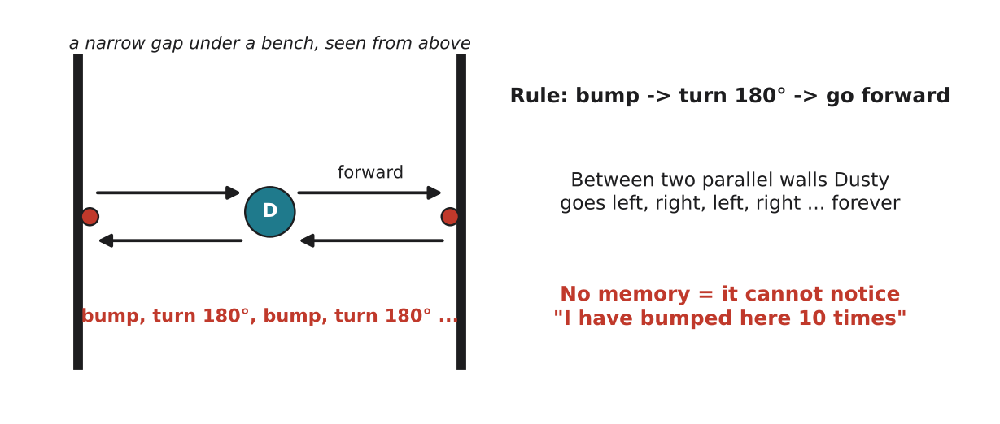

# 3.6 Strengths and limits of behaviorist AI

Author: Mussaldinov Rassul 1820262146 | Reviewed by: Kalbaev Beknazar 1820262361 | Status: checked

Read first: [3.4 Subsumption architecture](3-4-subsumption-architecture.md) and [3.5 Learning from rewards](3-5-learning-from-rewards.md)

## After this section you can

- list the main strengths and limits of behaviorist AI
- trace a situation in which a reactive robot gets stuck, and suggest a fix
- decide whether behaviorist AI suits a given task, and justify the decision
- explain why modern robots usually combine behaviorist AI with other approaches

## Start with an example

Dusty is brilliant at not falling down stairs. But ask it: "Clean the kitchen first, then the bedroom, and be finished before my guests arrive at 18:00." Dusty from 3.4 cannot do this at all. Its behaviors react to the present moment; they have no idea what a kitchen is, and no plan.

Every approach to AI is good at some things and bad at others. This lesson collects both sides for behaviorist AI.

## Words you need

- **Robust:** keeps working when things go wrong or change (a moved chair, a broken sensor reading).
- **Emergent behavior:** behavior of the whole system that no single rule describes, coming from simple rules interacting with the environment.
- **Planning:** choosing a sequence of actions in advance to reach a goal.
- **Hybrid system:** a system that combines approaches, for example reactive behaviors for safety plus a map and planning for efficiency.
- **SLAM (simultaneous localization and mapping):** building a map of a room while working out where you are in it; used by advanced robot vacuums with lidar or cameras.

## Explanation

### Strengths

| Strength | Why | Dusty example |
| --- | --- | --- |
| Fast | sensor goes almost directly to action, no long thinking | reverses at a cliff within a fraction of a second |
| Robust | no map that can become wrong | still works after you move the sofa |
| Cheap | simple sensors and a small chip (1.6, 1.7) | basic models cost much less than mapping models |
| Built step by step | add and test one layer at a time (3.4) | CARPET BOOST added without touching other behaviors |
| Emergent behavior | simple rules + a complex room = complex-looking behavior | cleans a whole room without a plan |

### Limits

| Limit | Why | Dusty example |
| --- | --- | --- |
| No planning or long-term goals | it only reacts to now | cannot "do the kitchen first" |
| No memory (purely reactive) | it cannot notice repeated failure | keeps cleaning the same clean area (3.3) |
| Can get trapped in loops | the same situation always gives the same reaction | the narrow-gap trap below |
| Hard to scale | many behaviors interact in surprising ways | adding a 20th behavior may break the others |
| No knowledge or language | it does not reason about facts | cannot answer "where did you find the most dirt?" |
| Learning needs many trials (3.5) | trial and error is slow and reward design is tricky | a real robot cannot fall down stairs 1,000 times to learn |

## Worked example: the narrow-gap trap

*Figure 3.6.1: Dusty under a narrow bench. With the rule "bump → turn 180° → go forward", it bounces between the two sides forever.*

Rule for this simple version: IF bumper pressed THEN turn 180° and go forward.

| Step | Situation | Rule | Action |
| --- | --- | --- | --- |
| 1 | driving right, no bump | wander | forward |
| 2 | hits the right side | bump | turn 180° |
| 3 | driving left | wander | forward |
| 4 | hits the left side | bump | turn 180° |
| 5 | driving right | wander | forward (same as step 1) |

Step 5 is exactly the same as step 1, so steps 1 to 4 repeat forever. Dusty never gets out and never cleans anything else.

**Two fixes:**

1. **Randomness:** turn a random angle between 120° and 240° instead of exactly 180°. Soon one turn points Dusty towards the open end and it escapes. (Many real robot vacuums use random turn angles.)
2. **A little memory:** count bumps; IF more than 5 bumps in 10 seconds THEN do a special escape move (for example, follow one wall). This makes Dusty slightly less "purely reactive".

## Try it yourself

**Q1. Decide and justify.** Does behaviorist AI suit each task well, partly, or badly? Explain each in one sentence.
a) a six-legged robot walking over rocks
b) a hospital robot that must deliver medicine to room 305 on the 3rd floor
c) a self-balancing scooter
d) a program that plays chess
e) a drone that must avoid birds while flying
f) answering questions about history

**Q2. Trace.** Dusty uses the rule "bump → turn 90° right → go forward" in a long corridor that is exactly as wide as Dusty's turning space, with a wall at the end. Describe what happens and whether Dusty gets stuck. (Hint: draw it.)

**Q3. Find the error.** "Behaviorist robots are useless because they cannot plan." Write a fairer sentence.

**Q4. Design a hybrid.** Design a robot vacuum that can "clean the kitchen first". Which parts would be behaviorist, and which would use a map and planning? Which part must have the final say in an emergency?

**Q5. Explain emergence.** Ants follow simple rules, but an ant colony builds complex nests. Give a Dusty example of emergent behavior, and explain why nobody "programmed" it directly.

## Answers

**Q1.**
a) **Well**: walking over rough ground is a fast sense-act task; Brooks's Genghis did exactly this.
b) **Partly**: reactive behaviors are needed for safety in corridors, but finding room 305 on the 3rd floor needs a map and planning (a hybrid).
c) **Well**: balancing is a fast feedback loop (3.2).
d) **Badly**: chess needs looking ahead many moves, which is planning and search (symbolism).
e) **Well** for the avoiding part: fast reaction to a sudden bird is exactly what reactive layers do (navigation to a destination needs more).
f) **Badly**: this needs knowledge and language (today usually connectionist models).

**Q2.** Dusty drives to the end wall and bumps, turns right and now faces a side wall, bumps again, turns right and faces back down the corridor. So it drives back out: it **escapes** after two bumps. 90° turns do not trap it here, while 180° turns in a narrow gap do. Small changes in rules or room shape change the behavior a lot, which is why reactive robots must be tested in many real situations.

**Q3.** "Behaviorist robots are excellent at fast, safe reactions in a changing world, but on their own they cannot plan long tasks, so they are often combined with planning systems."

**Q4.** Behaviorist (reactive) part: AVOID CLIFF, ESCAPE, and other safety behaviors, running all the time. Map and planning part: SLAM builds a map, the user marks the kitchen, a planner computes a route to clean the kitchen first. The **reactive safety layer must have the final say**: if the plan says "go forward" but the cliff sensor sees a drop, the robot must stop. This is how most modern robot vacuums are designed.

**Q5.** Example: Dusty with only WANDER, ESCAPE and random turn angles ends up covering almost the whole floor of a room. No rule says "cover the room"; the coverage comes from many random bounces interacting with the room's walls and furniture. The behavior emerges from the rules plus the environment.

## Common mistakes

- **Thinking a limit makes an approach useless.** Each approach fits some tasks; good engineers combine them.
- **Fixing every problem by adding behaviors.** Many interacting behaviors become hard to predict; sometimes a little memory or planning is the better fix.
- **Forgetting the environment.** A reactive robot's behavior depends as much on the room as on its rules.

## Sources

1. Brooks, R. A. (1991). Intelligence without representation. *Artificial Intelligence, 47*(1-3), 139-159.
2. Russell, S., & Norvig, P. (2021). *Artificial Intelligence: A Modern Approach* (4th ed.). Pearson. Chapter 26, "Robotics" (reactive control and hybrid architectures).
3. Wikipedia. "Behavior-based robotics." https://en.wikipedia.org/wiki/Behavior-based_robotics (accessed 5 Nov 2026)

Next: Part 4: [4.1 The robot vacuum: one system, three layers](../4-PUTTING_IT_TOGETHER/4-1-the-robot-vacuum.md)
