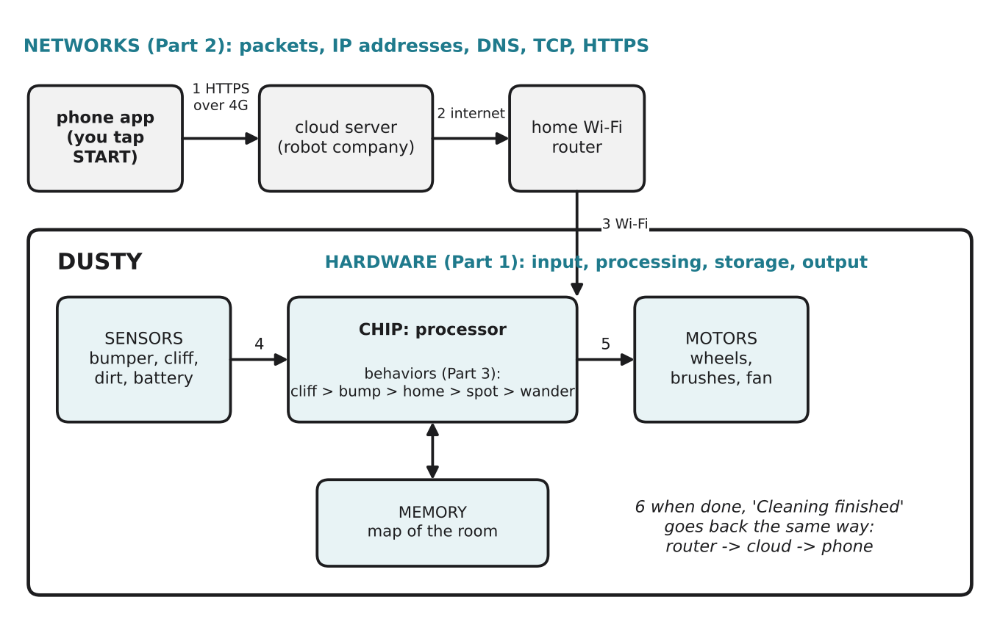

# 4.1 The robot vacuum: one system, three layers

Author: Mussaldinov Rassul 1820262146 | Reviewed by: Kalbaev Beknazar 1820262361 | Status: checked

Read first: Parts 1, 2 and 3. This section uses ideas from all of them.

## After this section you can

- follow one command from your phone all the way to Dusty's wheels, naming the hardware, network and AI ideas used at each step
- explain how the three parts of this module depend on each other
- trace an unexpected event through all three layers
- answer the question from our first lesson: is a robot vacuum a computer?

## Start with an example

You are in class at 14:00. You open Dusty's app and tap **Start**. At home, Dusty leaves its charger, cleans the flat, avoids the stairs, comes back, and your phone shows "Cleaning finished".

Every lesson of this module is hidden inside those few seconds. Let's open them up.

## Words you need

All terms in this section were introduced earlier. Use the [glossary](../../GLOSSARY.md) if one is unclear. The most important ones: input, processing, storage, output (1.1); memory (1.3); sensor and actuator (1.7); packet (2.2); IP address (2.3); TCP (2.5); DNS (2.6); HTTPS (2.7); feedback loop (3.2); reactive agent (3.3); subsumption (3.4).

## Explanation

*Figure 4.1.1: The journey of the Start command (steps 1 to 6). Networks carry the command, hardware senses and moves, and layered behaviors decide what to do.*

### The journey of one command

| Step | What happens | Ideas from this module |
| --- | --- | --- |
| 1 | You tap Start. The app finds the company server's IP address with **DNS** and sends the command over **HTTPS**, cut into **packets**, over 4G. | 2.2, 2.6, 2.7; the tap is **input** (1.1) |
| 2 | Routers forward the packets across the internet (a **WAN**) to the company's server, which passes the command towards your home's public **IP address**. | 2.1, 2.3 |
| 3 | Dusty keeps a connection to the server open all the time (it started this connection itself, so your home router lets the answer in). The command arrives over **TCP**, so nothing is lost, and goes up the **layers** to Dusty's control program. | 2.3, 2.4, 2.5 |
| 4 | Dusty's **sensors** report bumper, cliff, dirt and battery state. The **chip** runs its program with the **fetch, decode, execute cycle**. | 1.3, 1.4, 1.7 |
| 5 | The **behaviors** decide (cliff > bump > home > spot > wander), and the winning behavior sends commands to the **motors**. Wall following and speed control use **feedback loops**. The map is kept in **memory**. | 1.5, 3.2, 3.3, 3.4 |
| 6 | When finished, Dusty sends "Cleaning finished" back the same way: Wi-Fi, router, internet, server, your phone. The phone shows it: **output**. | 1.1, 2.1 to 2.7 |

### Why the three parts need each other

- Without **hardware**, there is nothing to sense or move, and nowhere to run the behaviors.
- Without **networks**, Dusty can still clean, but you cannot start it remotely, see the map, or get software updates.
- Without **behaviorist AI**, Dusty has sensors and motors but no way to turn readings into sensible actions in a changing room.

### Is a robot vacuum a computer?

Our first lesson asked this. Now you can answer with evidence: Dusty takes **input** (sensors, app commands), does **processing** (its chip runs the fetch, decode, execute cycle on a von Neumann design), uses **storage** (the map in memory), and produces **output** (motors, messages). It does all four jobs, so **yes, it is a computer**, one that also talks over a network and acts in the real world.

## Worked example: trace one surprising moment

At 14:20 Dusty is driving towards the stairs on its way home with 12 % battery, and at the same moment you tap **Pause** in the app.

1. **Networks:** the Pause command travels as packets over 4G and the internet to the server, then over Dusty's open TCP connection to the home router and by Wi-Fi to Dusty (2.1 to 2.5). This takes a fraction of a second, but it is not instant.
2. **Hardware:** meanwhile, the cliff sensors report "no floor ahead" (input, 1.7). The chip handles the reading within milliseconds (1.4, 1.6).
3. **Behaviorist AI:** AVOID CLIFF has the highest priority and suppresses GO HOME (3.4), so Dusty stops and reverses, probably **before** the Pause command even arrives.
4. When Pause arrives, Dusty's control program stops all behaviors that move it, and sends "Paused" back to your phone (output).

Lesson: safety must not depend on the network. The fast, local reactive layer protects Dusty even when a remote command is late or lost.

## Try it yourself

**Q1. Label the diagram.** Without looking at Figure 4.1.1, list the six steps of the Start command in order, and for each step name the module part (Hardware, Networks or Behaviorist AI) it mostly belongs to.

**Q2. Trace an event.** While cleaning, Dusty's dirt sensor detects a lot of dirt, and a new software update starts downloading. Describe what happens in each of the three layers. Which protocol should the update use, and which behavior controls the wheels?

**Q3. Find the error.** A student explains: "When I tap Start, my phone sends one big message directly to Dusty's IP address 192.168.1.37, and Dusty plans the best route through the whole flat." Find at least three mistakes.

**Q4. Predict failures.** What still works and what stops working in each case? a) the home router breaks b) the company's server is down c) Dusty's front bumper breaks

**Q5. Design.** Your team wants a new feature: "Avoid pet poop on the floor." Which hardware would you add, which school of AI (3.1) would recognize the poop, and where in Dusty's behavior list would the new AVOID behavior go? Justify each choice.

## Answers

**Q1.** 1 tap Start, sent by HTTPS over 4G (Networks; the tap is hardware input); 2 internet routers carry it to the company server (Networks); 3 command reaches Dusty over its open TCP connection and Wi-Fi (Networks); 4 sensors report, the chip processes (Hardware); 5 behaviors choose, motors act, feedback loops, map in memory (Behaviorist AI and Hardware); 6 "Cleaning finished" goes back to the phone (Networks, then output on the phone).

**Q2.** Hardware: the dirt sensor sends its reading (input); the chip processes it; the Wi-Fi module receives update packets; the update is saved in storage. Networks: the update is downloaded with **TCP**, because every byte must be correct (2.5). Behaviorist AI: SPOT CLEAN becomes active and controls the wheels (unless cliff, bump or go home is active). The download and the cleaning happen at the same time and do not compete: they use different parts of the hardware.

**Q3.** 1) The phone does not send directly to 192.168.1.37: that is a **private** address, valid only inside the home LAN; the command goes through the company server and the home router (2.3). 2) It is not one big message: data travels in **packets** (2.2). 3) Basic Dusty does **not plan** a route; it reacts with layered behaviors (3.4, 3.6). (Advanced models with maps can plan, but that is a hybrid.)

**Q4.** a) Router broken: Dusty can still clean if started by its own button, and its behaviors still work, but the app cannot reach it. b) Server down: same as a), the app cannot start or see Dusty, but local cleaning works. c) Bumper broken: networks work and the app still starts Dusty, but the ESCAPE behavior never triggers, so Dusty may keep pushing against furniture (1.1, Q6).

**Q5.** Hardware: a front **camera** and a processor strong enough to run a small neural network (1.7). School: **connectionism**, a neural network trained on many photos, because poop has no simple sensor signature. Behavior: AVOID POOP placed high in the list, just below AVOID CLIFF (above ESCAPE), because driving through it is worse than bumping into a chair. The result is a hybrid: a connectionist detector feeding a behaviorist layer.

## Common mistakes

- **Thinking the app talks to the robot directly.** It usually goes through the company's server.
- **Thinking the network makes Dusty safe.** Safety reactions are local and must work without the network.
- **Treating the three parts separately.** The point of this module is that real systems need all three together.

## Sources

This section combines the sources of sections 1.1 to 3.6. Additional source:

1. Wikipedia. "Robotic vacuum cleaner." https://en.wikipedia.org/wiki/Robotic_vacuum_cleaner (accessed 5 Nov 2026)
2. Kurose, J. F., & Ross, K. W. (2021). *Computer Networking: A Top-Down Approach* (8th ed.). Pearson. Chapter 4, section on Network Address Translation (NAT).

End of the module. Practise with the Test Bank and go back to any section marked in your answers.
